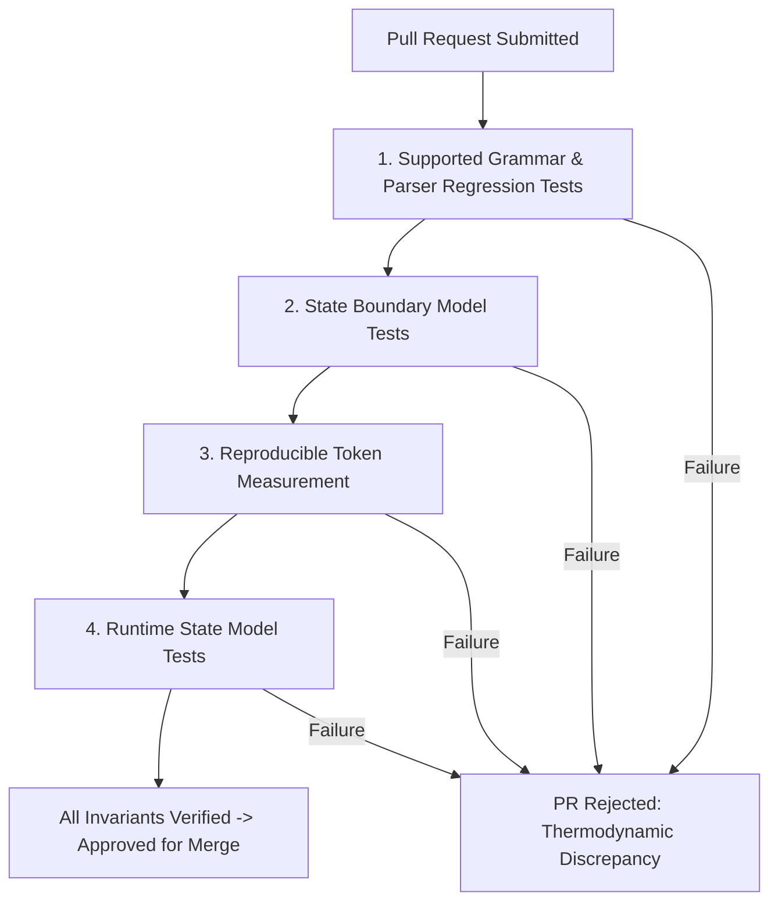

# HumOS & LINGHOS Contribution Guidelines
**Document Identifier:** `GOV-CONTRIB-20261108-EN`  
**Standard Status:** `Official Project Governance Specification`  
**Classification:** `Open-Source Developer Workflow & Protocol Standards`  
**Maintainer:** `SystemAdmin01`  

---

## 1. Code of Technical Conduct & Architectural Philosophy

HumOS aims for predictable, testable behavior in its implemented compiler and state model. LINGHOS can serve as a compact intermediate representation for downstream Large Language Model (LLM) applications, but the current repository does not enforce deterministic LLM inference.

Every contribution—whether a parser patch, visual cockpit enhancement, or documentation revision—must strictly preserve:
1. **Deterministic compiler behavior:** For a fixed source and runtime state, supported parsing and serialization paths must be repeatable and covered by tests.
2. **Measured context budgeting:** Token-efficiency claims must identify the tokenizer, corpus, and measurement method; do not publish unverified reduction percentages.
3. **Explicit simulation boundaries:** State that VM, RAM, BPM, and defense values are application-level models unless real host-level enforcement or sensor integration exists.

---

## 2. Primitive Proposal Protocol (PPP)

Any addition to the LINGHOS language, documented primitives, or execution behavior must follow the **Primitive Proposal Protocol**. Keep proposed syntax clearly distinguished from runtime-supported commands; the current parser is line-oriented and does not construct a formal AST.

### 2.1 Criteria for Primitive Acceptance
Before submitting a proposal for a new primitive (e.g., `MEMORY.*`, `THREAD.*`, `SHIELD.*`), the author must demonstrate that:
1. **Non-Redundancy:** The capability cannot be synthesized using an existing primitive sequence (e.g., `RAM.alloc()` + `THREAD.spawn()`).
2. **Context Window Efficiency:** Report the token footprint using a named tokenizer and version. Apply a 24-token target only when the tokenizer and measurement corpus are specified; UTF-8 encoding is not itself a BPE tokenizer.
3. **Deterministic State Transition:** The primitive must yield a mathematically provable state change in the runtime memory model (e.g., deallocating RAM, clamping BPM, or altering threat radius).
4. **Backward Parser Compatibility:** Add regression tests for supported parser behavior and malformed input. The current parser is hand-written and is not an LR(1) parser.

### 2.2 Formal RFC Template for Primitive Proposals
Every primitive proposal must be submitted as an issue or pull request referencing `docs/SPEC.md` using the following technical schema:

```markdown
### Primitive Specification: [DOMAIN].[identifier]
- **Syntax Specification:** `Call >> [DOMAIN].[identifier](<args>);`
- **Arity & Types:** Explicit argument types (e.g., `(target_id: Identifier, limit: Integer)`).
- **Runtime Memory Semantics:** Concrete state modification in `HumOSKernel` (e.g., RAM impact, thread registration).
- **Spatial / Thermodynamic Invariant Impact:** Direct effect on proximity radius ($r$) or heart rate ($BPM$).
- **Fallback & Exception Behavior:** Error code emitted if execution faults (e.g., `ERR_BUFFER_OVERFLOW`).
- **Token Benchmark:** BPE token count for syntax invocation.
```

---

## 3. Pull Request Verification Standard (PRVS)

Every Pull Request (PR) must satisfy an automated and manual verification checklist prior to review and merge.



### 3.1 Step-by-Step Verification Checklist

- [ ] **1. Strict Grammar & Lexer Compliance**
  - Changed and referenced examples are checked against the currently supported parser/compiler subset.
  - Semicolons, block closures (`Main() { ... }`), directives (`/SET_Lockdown_Mode`), and macro headers (`#include`) strictly follow the grammar defined in `docs/SPEC.md`.
  - No trailing whitespace or broken delimiters.

- [ ] **2. Context Leak Verification (Zero Prompt Bleeding)**
  - Tests must verify the modeled target/VM associations and ensure no accidental cross-state mutation. Do not describe application VM objects as OS-level isolation.
  - Prompt payload construction must escape and delimit untrusted source content; downstream LLM policy remains outside this runtime's enforcement boundary.

- [ ] **3. Token Footprint Benchmark**
  - Token claims must include a reproducible raw-input corpus, tokenizer name/version, serialization rules, repeated measurements, and raw results. Do not impose an 85% reduction target until a baseline benchmark has been published.
  - Track byte size and token count as separate measurements; bytes are not tokens.

- [ ] **4. Thermodynamic Invariant Unit Tests**
  - Model test: Verify that `Call >> Drop_All_Background_Threads;` produces the documented modeled telemetry in the current implementation. Treat `RAM.purge()` as specification-only until implemented.
  - Spatial radius test: Verify that threat proximity radius satisfies $r = \max(50.0, 175.0 - (W \cdot 6.5 + C \cdot 5.5))$.
  - Defensive clamp test: Verify that `Ice_shield` prevents thermal throttling when RAM exceeds $85\%$.

---

## 4. Conventional Commit Standards & HumOS Scopes

Commit messages must strictly follow the **Conventional Commits 1.0.0** specification. Random, unformatted commit messages (e.g., `update code`, `fix stuff`) will be blocked by repository pre-receive hooks.

### 4.1 Commit Structure
```text
<type>(<scope>): <short imperative summary>

[optional body providing technical justification]

[optional footer referencing issue or breaking change]
```

### 4.2 Approved Types & HumOS-Specific Scopes

| Scope | Description | Permitted Types | Example |
| :--- | :--- | :--- | :--- |
| `linghos` | LINGHOS language syntax, lexical scanner, compiler and parser behavior | `feat`, `fix`, `refactor` | `fix(linghos): add regression coverage for supported syntax` |
| `parser` | Parsing engine, block scanning, statement normalization | `fix`, `perf`, `test` | `fix(parser): handle malformed nested IF blocks safely` |
| `cockpit` | Web UI, interactive SVG radar canvas, HTML/JS console | `feat`, `fix`, `style` | `feat(cockpit): render active defense labels on SVG perimeter` |
| `gap` | G.A.P. protocol specification and supported defensive state transitions | `sec`, `fix`, `feat` | `docs(gap): clarify protocol runtime implementation boundary` |
| `spec` | Formal documentation, language contracts, developer guides | `docs` | `docs(spec): document RAM.alloc memory invariants` |
| `storage` | Local scenario persistence, JSON serializations, sessions | `feat`, `fix`, `test` | `feat(storage): support custom symbol de-registration` |

### 4.3 Commit Message Examples

#### ✅ Valid Commit Messages
```bash
feat(linghos): implement the supported LINGHOS syntax
fix(parser): prevent variable leakage across multi-VM declarations
fix(gap): clarify protocol runtime enforcement boundary
docs(spec): update Section 3 primitive matrix with arity contracts
```

#### ❌ Invalid Commit Messages
```bash
updated readme.md                 # Missing type and scope
fix bug in script                 # Non-standard scope, non-imperative tone
WIP: cockpit stuff                # Inadmissible staging tag in commit history
feat: added things to parser      # Missing scope, past tense verb
```

---

## 5. Development Environment Setup & Validation

To test contributions locally:

```bash
# 1. Clone repository
git clone https://github.com/SystemAdmin01/HumOS.git
cd HumOS

# 2. Validate compiler and storage engine (implemented subset)
python3 -c "
from src.linghos.compiler import LINGHOSCompiler
from src.linghos.storage import GLOBAL_STORAGE
compiler = LINGHOSCompiler()
res = compiler.compile('Main() { Call >> Ice_shield; <<@end }')
assert res['telemetry']['ice_shield'] is True
print('Compiler verification passed.')
"

# 3. Run the regression tests\nPYTHONPATH=src python3 -m unittest discover -s tests -v\n\n# 4. Launch the local Cockpit
python3 src/app.py
```

---

*Authored under the HumOS Specification Group.*  
*Official Repository:* [https://github.com/SystemAdmin01/HumOS](https://github.com/SystemAdmin01/HumOS)
