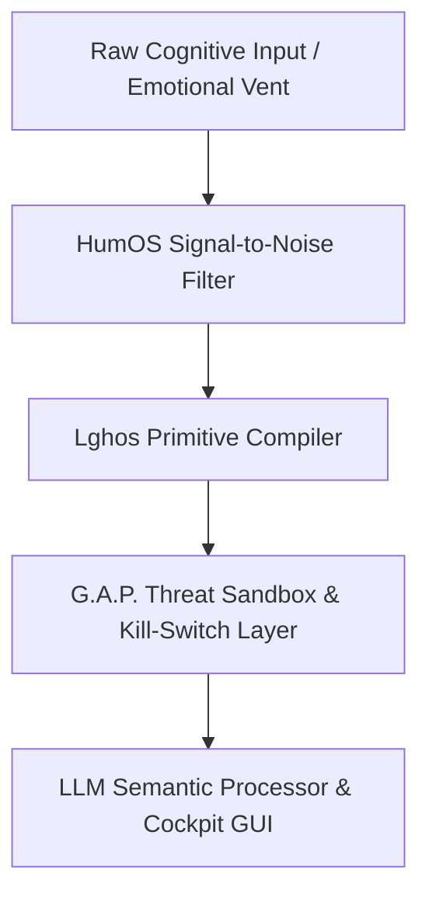

# 🧠 HumOS — Human Operating System

### Your mind is not broken. It deserves an explicit operating system.

**HumOS is an opinionated, low-overhead cognitive state-vector kernel for ADHD, neurodivergent workflows, and people who overthink.** It transforms unstructured inputs—including emotional vents, competing priorities, and noisy context—into compact, structured, deterministic payloads for downstream reasoning. By separating signal from noise and serializing state explicitly, HumOS is designed to reduce ambiguity, limit context drift, and make cognitive workflows easier to inspect and control.

[](#architecture)
[](#gap-security-layer)
[](#humos-cockpit)
[](#documentation)
[](LICENSE.txt)

[English documentation](docs/GUIDE.md) · [Documentazione italiana](docs/GUIDE_IT.md) · [HumOS Cockpit](src/linghos/cockpit.html) · [Examples](examples/)

---


## What HumOS does

HumOS applies operating-system concepts to cognitive self-management. It treats attention, working memory, recurring thought loops, perceived threats, and personal boundaries as explicit state that can be named, inspected, and handled through a small domain-specific language.

| Cognitive signal | HumOS model | Intended role |
| :--- | :--- | :--- |
| Working-memory overload | RAM pool and memory buffers | Make cognitive load visible and support explicit cleanup |
| Rumination and repetitive thought | CPU / associative loop | Detect repeated cycles and provide interruption paths |
| External stressors | Threat targets with weight and criticality | Represent perceived impact and proximity |
| Self-regulation strategies | Defense shields | Model boundaries and protective responses |
| Personal and external context | Isolated virtual-machine concepts | Keep distinct contexts from being conflated |
| Core identity and boundaries | Core Self (CS) state | Make the protected state explicit |

HumOS is a cognitive organization and reflection framework, not a medical device or a substitute for professional care.

## Architecture

The execution path is designed to move from noisy human input to a compact, inspectable representation before downstream semantic processing.



### The core layers

1. **Signal-to-Noise Filter** — identifies the useful signal in unstructured input and separates it from repetition, ambiguity, and irrelevant context.
2. **LINGHOS DSL and compiler** — expresses cognitive state through explicit primitives and a constrained grammar, then parses that representation into structured data.
3. **G.A.P. security layer** — **Guard, Analyze, Patch**: documents sandbox boundaries, loop-interruption policies, threat handling, and kill-switch behavior.
4. **LLM integration and HumOS Cockpit** — passes structured state to downstream semantic workflows while the visual interface makes the model, telemetry, and defensive actions inspectable.

> **Naming note:** the architecture badge uses the requested label `Lghos v1.0`; the language and compiler package in the repository are named **LINGHOS**.

## LINGHOS — the cognitive DSL

LINGHOS (**Language for Interfacing Neurodivergent Gestalt Human Operating Systems**) is the low-level language of HumOS. It provides a compact, readable way to declare targets, assign state, invoke protections, and describe bounded actions.

```linghos
// Example: isolate a high-priority stressor
Get: HostileTarget(target)[8];
Set_CriticVal >> target = [9];

Main() {
    @Start>(HP_EXT_Defense_VM) {
        ON> target;
    }

    IF(CS_EXPOSED) {
        Call >> Ice_shield;
        Call >> Double_Bottom_Shield;
    }

    <<@end
}
```

The grammar, primitives, and language contract are documented in the [LINGHOS specification](docs/SPEC.md). Runnable scenarios are available in [examples/](examples/).

## G.A.P. security layer

**G.A.P. — Guard, Analyze, Patch** is HumOS's cognitive-security and containment protocol. It provides a vocabulary and policy layer for handling untrusted input, isolating volatile state, interrupting runaway loops, and invoking a hard-stop path when configured invariants are violated.

Key concepts include:

- **Guard:** define boundaries around protected state and isolate untrusted or high-criticality inputs.
- **Analyze:** inspect state, threat criticality, loop behavior, and context-boundary violations.
- **Patch:** apply a mitigation, clear or quarantine state where supported, and stop execution when a configured threshold is crossed.

G.A.P. is a framework-level protection model. Its guarantees depend on the runtime primitives and enforcement paths actually enabled; the protocol documentation is not an independent security certification.

See the [Security Policy](SECURITY.md), [Italian Security Policy](docs/SECURITY_IT.md), and [G.A.P. protocol materials](protocols/).

## HumOS Cockpit

The **HumOS Cockpit GUI** is a local, browser-based visual console. It keeps the human-facing experience central rather than reducing HumOS to a DSL or command-line tool.


The Cockpit is designed to provide:

- **Threat Proximity Radar** — visualizes threat targets using their configured weight and criticality.
- **Defense Shield Controls** — represents protections such as Ice Shield, Double-Bottom, and Lockdown.
- **Drag-and-Drop Defense Palette** — lets users compose defensive actions visually and generate corresponding LINGHOS structures.
- **Live Telemetry** — surfaces RAM usage, BPM, Core Self state, and thermal-throttling indicators where available.
- **Symbol Registry** — exposes custom symbols and reusable command definitions.
- **Interactive Command Manual** — makes language constructs discoverable from the interface.

The frontend is located at [`src/linghos/cockpit.html`](src/linghos/cockpit.html); the local application entry point is [`src/app.py`](src/app.py).

## Benchmarks: determinism and token efficiency

The following matrix captures the project's **indicative design targets** for a comparable input—not independently reproduced benchmark results.

| Performance Metric | Natural Language Prompting | LINGHOS Serialized Vector | System Advantage |
| :--- | :--- | :--- | :--- |
| **Context Window Footprint** | ~650–1,200 tokens | ~90–180 tokens | **~80%–85% fewer tokens*** |
| **Parsing & Execution Latency** | Variable; interpretation can drift | Grammar-driven parsing path | **Predictable parsing; latency measurement pending** |
| **State Vector Integrity** | Implicit state; omissions and drift are possible | Explicit, validated state representation | **Deterministic serialization** |
| **Memory Protection** | Context can accumulate across turns | Explicit buffer lifecycle; `RAM.purge` where implemented | **Defined cleanup path, not a zero-saturation guarantee** |
| **Loop & Overthink Control** | Retry and loop behavior often sits outside the prompt | G.A.P. thresholds and kill-switch policy | **Explicit termination path when enforcement is enabled** |

\* Token figures are estimates and depend on the input, tokenizer, and serialization format. The reduction assumes like-for-like inputs; reproduce measurements with the same tokenizer and a published benchmark corpus before treating them as performance claims. Deterministic serialization does **not** make downstream LLM inference deterministic.

## Quick start

### Run from source

Requirements: Python 3.11+.

```bash
git clone https://github.com/SystemAdmin01/HumOS.git
cd HumOS/src
python3 app.py
```

The local server starts the Cockpit; open the local address printed by the application in your browser. The project is designed to use Python's standard library and browser-native HTML, CSS, and JavaScript.

### macOS application

Prebuilt macOS packages, when published, are available from [GitHub Releases](https://github.com/SystemAdmin01/HumOS/releases). Follow the release-specific instructions included with the package.

## Documentation

| Documentation | English Version | Versione Italiana | Scope |
| :--- | :--- | :--- | :--- |
| **Language Spec** | [`docs/SPEC.md`](docs/SPEC.md) | [`docs/SPEC_IT.md`](docs/SPEC_IT.md) | Formal syntax, primitives, and AST grammar |
| **Developer Guide** | [`docs/GUIDE.md`](docs/GUIDE.md) | [`docs/GUIDE_IT.md`](docs/GUIDE_IT.md) | Pipeline walkthrough, runtime concepts, and prompt-injection considerations |
| **Code Examples** | [`examples/`](examples/) | [`examples/`](examples/) | LINGHOS scripts and Python integration examples |
| **Contribution** | [`CONTRIBUTING.md`](CONTRIBUTING.md) | [`docs/CONTRIBUTING_IT.md`](docs/CONTRIBUTING_IT.md) | Pull-request verification and contribution conventions |
| **Security Protocol** | [`SECURITY.md`](SECURITY.md) | [`docs/SECURITY_IT.md`](docs/SECURITY_IT.md) | Vulnerability disclosure, threat model, and G.A.P. limits |

### Example scenarios

- [Loop isolation](examples/01_loop_isolation.lghos)
- [RAM dump](examples/02_ram_dump.lghos)
- [G.A.P. loop interruption](examples/GAP-001_paranoia_break.lgh)
- [Working-memory flush](examples/adhd_ram_flush.lgh)
- [Incident response](examples/incident_01.lgh)
- [Python integration](examples/demo_pythonic.py)

## Repository layout

```text
HumOS/
├── assets/                 # Cockpit screenshots and visual assets
├── docs/                   # English and Italian specifications and guides
├── examples/               # LINGHOS scripts and Python examples
├── protocols/              # G.A.P. and cognitive safety protocols (EN / IT)
├── src/
│   ├── app.py              # Local application entry point
│   ├── HumOS_Cockpit.command
│   └── linghos/
│       ├── compiler.py     # LINGHOS compiler
│       ├── parser.py       # Grammar and parsing engine
│       ├── kernel.py       # Cognitive runtime and state management
│       └── cockpit.html    # HumOS Cockpit GUI
├── updates/                # Release notes and patches
├── CONTRIBUTING.md
├── LICENSE.txt
├── README.md
└── SECURITY.md
```

## Contributing

Contributions to the DSL, kernel, security protocols, and Cockpit are welcome. Please read the [English contribution guide](CONTRIBUTING.md) or [guida italiana](docs/CONTRIBUTING_IT.md) before opening a pull request.

## License

HumOS is distributed under the [MIT License](LICENSE.txt).

---

**HumOS** · Cognitive engineering for the neurodivergent mind.  
Designed and maintained by [SystemAdmin01](https://github.com/SystemAdmin01).
