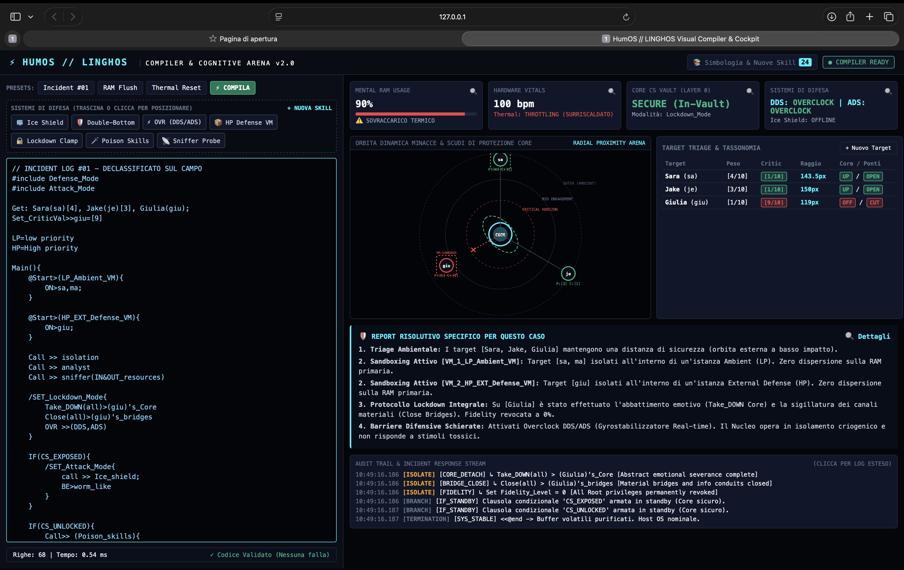

<div align="center">

# 🧠 HumOS — Human Operating System

### *Your brain runs on an OS. HumOS gives you root access.*

**An engineering-based cognitive framework for ADHD, neurodivergence, and overthinkers.**  
*Transform mental friction into structured cybernetic clarity — using computer architecture logic.*

---

[](LICENSE.txt)
[]()
[]()
[]()
[]()

---

[🇮🇹 Documentazione Italiana](./docs/it/README.md) • [🇬🇧 English Documentation](./docs/en/README.md) • [🛡️ Cockpit Web UI](#-interactive-cockpit--visual-compiler) • [🩹 Protocols](./protocols/en/)

</div>

---

<p align="center">
  
</p>

<div align="center">

> *"Your mind is not broken. It just lacks an explicit operating system."*

</div>

---

## 🖥️ What is HumOS?

**HumOS** bridges cognitive psychology, ADHD management, and operating system principles. Instead of ambiguous emotional journaling, HumOS maps neurodivergent cognitive states directly to computer architecture:

| Human Cognitive State | HumOS Cybernetic Mapping | Engine Role |
| :--- | :--- | :--- |
| **Working Memory** | **RAM Memory Pool** | Monitored to avoid cognitive leaks and thrashing |
| **Anxiety / Rumination** | **CPU-Loop / Infinite Execution** | High-cycle drain stopped via interrupt triggers |
| **Interpersonal Threats** | **Threat Targets with Weight & Criticality** | Positioned dynamically in visual proximity arena |
| **Self-Regulation Skills** | **Defense Shields (Ice Shield, Double-Bottom)** | Firewalls separating raw data from emotional charge |
| **Emotional Boundaries** | **Sandbox Virtual Machines (PRS_VM, EXT_VM)** | Isolates volatile variables from the core identity |
| **Core Vulnerability** | **CS (Core Self) State [SECURE, EXPOSED, UNLOCKED]** | Protected kernel status regulating defensive posture |
| **Sensory / Panic Overwhelm** | **Thermal Throttling & Biofeedback Clamps** | Heart-rate dampening and physiological resets |

---

## ⚡ LINGHOS — The Cybernetic Language of the Mind

**LINGHOS** is the domain-specific language (DSL) powering HumOS. Write readable architectural code to diagnose, isolate, and defend your mental state:

```linghos
// INCIDENT: Toxic variable attempting emotional drain
#include <Defense_Mode>

Get: HostileTarget(htg)[8], ChaoticEvent(evt)[6];
Set_CriticVal >> htg = [9]

Main() {
    // 1. Isolate threats into high-priority sandboxes
    @Start>(HP_EXT_Defense_VM) {
        ON> htg, evt;
    }

    // 2. Intercept loop & engage cryogenic shields if core exposed
    IF(CS_EXPOSED) {
        Call >> Ice_shield;
        Call >> Double_Bottom_Shield;
        OVR >> (DDS, ADS);
    }

    // 3. Complete emotional lockdown: sever bridges & fidelity
    /SET_Lockdown_Mode {
        Take_DOWN(all) > (htg)'s_Core
        Close(all) > (htg)'s_bridges
    }

    <<@end
}
```

The HumOS compiler parses the code, evaluates thermodynamic telemetry, calculates threat orbits, and outputs immediate, structured mitigation steps.

---

## 🛡️ Interactive Cockpit & Visual Compiler

The **HumOS Cockpit** (`src/linghos/cockpit.html`) is a standalone cybernetic console running locally in your browser:

* 🎯 **Dynamic Threat Proximity Radar**: Renders real-time orbits where threat distance is directly determined by emotional weight $[1..10]$ and criticality $[1..10]$.
* 🛡️ **Active Defense Shields**: Visual representation of deployed shields (`Ice Shield`, `Double-Bottom`, `Lockdown`) buffering the Core.
* 🖱️ **Drag-and-Drop Defense Palette**: Drag shields directly onto the arena to synthesize LINGHOS code automatically.
* 📡 **Live Thermodynamic Telemetry**: Real-time meters for **RAM %**, **BPM Heart Rate**, **Core Self (CS) State**, and **Thermal Throttling Alert**.
* 🤖 **Autonomous Symbol Registry**: Dynamically discovers and learns custom skills and macro definitions on the fly.
* 📖 **Built-in Interactive Command Manual**: Full clickable reference for all language constructs.

---

## 🚀 Quick Start (Instant Launch)

### 🍎 Option 1 — macOS One-Click App (Recommended)
1. Download [**HumOS.app.zip**](https://github.com/SystemAdmin01/HumOS/releases) from Releases.
2. Unzip and double-click **`HumOS.app`**.
3. Your browser automatically opens at `http://127.0.0.1:8080`.

*(First-time macOS notice: Right-click `HumOS.app` → **Open**).*

### 💻 Option 2 — Run from Source (Universal)
```bash
# Clone the repository
git clone https://github.com/SystemAdmin01/HumOS.git
cd HumOS/src

# Launch the visual cockpit
python3 app.py
```
*Zero external dependencies required. Pure Python 3 standard library + vanilla web standards.*

---

## 📁 Repository Architecture

The codebase follows enterprise repository standards:

```text
HumOS/
├── assets/                     # Media, high-resolution screenshots & UI previews
│   └── humos_cockpit_preview.png
│
├── docs/                       # Comprehensive documentation
│   ├── it/                     # 🇮🇹 Italian manual & full LINGHOS reference
│   └── en/                     # 🇬🇧 English manual & complete framework guide
│
├── examples/                   # Executable LINGHOS scripts & scenarios
│   ├── adhd_ram_flush.lgh      # Instant cognitive memory purger
│   ├── incident_01.lgh         # Complete perimeter defense sample
│   ├── GAP-001_paranoia.lgh    # Chaotic loop interrupt implementation
│   └── demo_pythonic.py        # Python SDK integration demonstration
│
├── protocols/                  # Tactical cognitive intervention protocols
│   ├── it/                     # Italian protocol specifications (G.A.P., Safe Mode)
│   └── en/                     # English protocol specifications
│
├── src/                        # Core Python Engine & Interactive Cockpit
│   ├── app.py                  # Server entrypoint
│   ├── HumOS_Cockpit.command   # Native macOS executable launcher script
│   ├── pyproject.toml          # Modern packaging configuration
│   └── linghos/                # Core language compiler package
│       ├── compiler.py         # Lexer, AST evaluator & symbol learner
│       ├── kernel.py           # Cognitive OS runtime state manager
│       ├── models.py           # Domain dataclasses & telemetry structures
│       ├── parser.py           # LINGHOS grammar engine
│       ├── web.py              # Low-latency local HTTP & REST API server
│       └── cockpit.html        # Interactive visual frontend application
│
├── updates/                    # Version changelogs and system patches
│   ├── Patch00-ITA.md
│   └── Patch00-ENG.md
│
├── LICENSE.txt                 # MIT Open Source License
└── README.md                   # Repository landing page
```

---

## 🩹 Standard Protocols Catalog

| Protocol ID | Classification | Objective | Implementation |
| :--- | :--- | :--- | :--- |
| **`PATCH-00`** | System Lockdown | Safe Mode Offline: complete isolation & external input disconnect | [`updates/Patch00-ENG.md`](./updates/Patch00-ENG.md) |
| **`GAP-001`** | Loop Interrupt | G.A.P. Protocol: Active paranoia management & unclassified loop brake | [`protocols/en/GAP-001-protocol.md`](./protocols/en/GAP-001-protocol.md) |

---

## 🌐 Language Areas / Aree Linguistiche

* 🇮🇹 **[Documentazione Ufficiale in Italiano](./docs/it/README.md)** — Leggi la guida approfondita, il manifesto di ingegneria cognitiva e la sintassi completa di LINGHOS.
* 🇬🇧 **[English Official Documentation](./docs/en/README.md)** — Read the core framework architecture, ADHD operating models, and LINGHOS manual.

---

## 📄 License

Distributed under the **MIT License**. See [`LICENSE.txt`](LICENSE.txt) for more details.

---

<div align="center">

**HumOS Project** • Designed with precision by [SystemAdmin01](https://github.com/SystemAdmin01)  
*Cognitive Engineering for the Neurodivergent Mind.*

</div>
