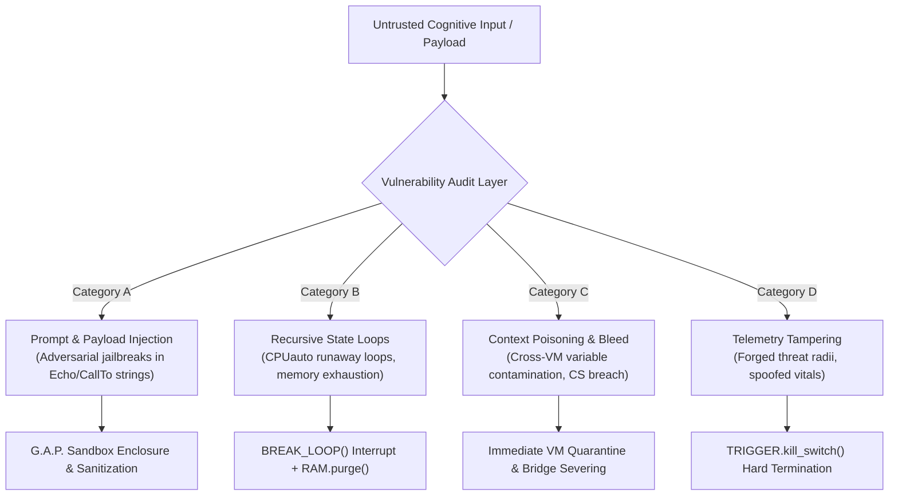

# HumOS & LINGHOS Cognitive Security Policy
**Document Identifier:** `SEC-POLICY-20261108-EN`  
**Standard Status:** `Project Security Policy & Vulnerability Disclosure Guide`  
**Classification:** `Runtime Safety Architecture & Threat Model`  
**Security Contact:** [SystemAdmin01 on GitHub](https://github.com/SystemAdmin01)  

---

## 1. Cognitive Security Model & Threat Landscape

HumOS systems operate at the interface between biological human cognition and downstream Large Language Model (LLM) agents. In this architecture, security failures are not limited to traditional buffer overflows or network exploits; they encompass **cognitive vulnerabilities** capable of triggering cognitive loop locks, prompt poisoning, stochastic inference hijacking, or context boundary breaches.

The primary mission of the HumOS Cognitive Security Architecture is to ensure that no input payload—whether generated by malicious external actors, adversarial LLM feedback, or high-arousal internal affective states—can compromise the **Core Self (`CS_SECURE`)** or cause unconstrained host resource exhaustion.

---

## 2. In-Scope Vulnerability Classes

The following vulnerability classes are explicitly in scope for security evaluations, bug reports, and penetration audits:

### 2.1 Category A: Cognitive Injection Vectors (CIV)
- **Adversarial Payload Injection:** Escape sequences embedded in `Echo("...")` or `Get: Variable(alias)` statements that trick the downstream LLM interpreter into disregarding system instructions or executing unauthorized external actions.
- **Indirect Cognitive Injection:** Malicious text streams ingested from external communications (emails, Slack messages, social inputs) designed to trigger automated high-criticality lockups.

### 2.2 Category B: Runaway Associative Loops & State Starvation (RSL)
- **Recursive CPU Loops:** Exploit payloads triggering indefinite loop states in `Assoc_Engine` where `Assoc_Engine.status == LOOP` fails to break, driving working memory allocation to $100\%$ and triggering cognitive freeze.
- **Context Window Flooding:** Deliberately un-demodulated inputs engineered to consume thousands of tokens in cyclic re-evaluations.

### 2.3 Category C: Context Poisoning & Cross-VM Bleeding (CPB)
- **Perimeter Leakage:** Data variables crossing from an isolated personal sandbox (`PRS_VM`) or ambient sandbox (`LP_Ambient_VM`) into the protected Core Self (`CS_KERNEL`) without passing through `Double_Bottom_Shield`.
- **Fidelity Hijacking:** Exploits modifying target node fidelity percentages or reopening closed communication bridges (`Close(all)`) without explicit operator authentication.

### 2.4 Category D: Telemetry Spoofing & Invariant Tampering (TIT)
- **Spatial Threat Manipulation:** Forging calculation variables such that an active threat target is falsely positioned outside the critical proximity orbit ($r > 150\text{px}$ instead of $r < 55\text{px}$).
- **Vitals Masking:** Suppressing physiological spike alerts (e.g., masking $BPM \ge 120$) to prevent automatic engagement of `Ice_shield` or physiological sighs.

---

## 3. Sandbox Isolation Invariants — G.A.P. Design Targets

> **Implementation boundary (package 1.0.0):** This policy describes intended controls and the threat model; it is not a security certification. The current runtime models target/VM state but does not provide operating-system VM isolation, a G.A.P. loop watchdog, or the documented `TRIGGER.kill_switch()` primitive. The Cockpit server binds to loopback, rejects cross-origin browser POST requests, and caps JSON request bodies at 1 MiB. It does not authenticate local users or processes. Do not expose it through a public interface, reverse proxy, or tunnel.

The **G.A.P.** protocol (GAP-001, **Active Paranoia Management**) defines the project's intended containment and response model. Runtime enforcement is partial; see the implementation boundary below.

### 3.1 Intended Containment Targets (Not Runtime Guarantees)
1. **Protected-State Boundary:** The design target is to engage `Ice_shield` and `Double_Bottom_Shield` when `CS_EXPOSED` is detected. The current runtime models selected shield states; it does not enforce a non-bypassable semantic firewall.
2. **Strict VM Quarantine:** Any target declared with threat score $\ge 7.0$ is forced into `HP_EXT_Defense_VM`. It cannot access shared working memory segments or ambient threads.
3. **Loop Interruption:** The protocol specifies a proposed timeout and `BREAK_LOOP(X)` response. The current runtime does not ship a G.A.P. watchdog, `BREAK_LOOP()`, or `SET_VALUE()` primitive.

### 3.2 Proposed Hard-Stop Behavior — `TRIGGER.kill_switch()`
The architectural target is to request an immediate abort (`TRIGGER.kill_switch()`) under the following critical conditions. This primitive is not implemented by the current runtime:
- **Corrupted State Vector:** A future parser/validation layer detects malformed source or contradictory modeled state (e.g., `CS_SECURE` asserted while `core_connected == True` on a lockdown target).
- **Injection Signature Detected:** An input variable contains active exploit syntax targeting downstream LLM tokenizers.
- **Biometric Saturation Threshold:** Autonomic heart rate breaches $130\text{ BPM}$ or working memory load reaches $95\%$.

#### Proposed response sequence if implemented:
If a future runtime implements and activates `TRIGGER.kill_switch()`, the intended sequence is:
1. The runtime would close the modeled communication bridges: `Close(all) > bridges`.
2. The modeled target fidelity would be set to zero: `Fidelity = 0%`.
3. The modeled core connection would be cleared: `Take_DOWN(all) > Core`.
4. The modeled defense overrides would be applied: `OVR >> (DDS, ADS)`.
5. The modeled host state enters zero-fidelity cold standby until manual operator authentication.

---

## 4. Threat Severity Matrix & Target Resolution Windows

Vulnerabilities reported to the HumOS Security Team are classified according to the **Cognitive Security Vulnerability Scoring (CSVS)** model:

| Severity Level | Threat Definition | Operational Impact | Target Resolution Window* |
| :--- | :--- | :--- | :--- |
| **CRITICAL** | Direct breach of Core Vault (`CS_UNLOCKED`); uncatchable recursive loop causing total cognitive freeze; prompt injection leading to unauthorized external tool execution. | Complete loss of cognitive boundary; severe emotional dysregulation; arbitrary LLM dispatch. | **Patch within 24 Hours** |
| **HIGH** | Failure of `G.A.P.` sandbox to isolate a high-threat target ($C \ge 8$); memory leak in `RAM.alloc()` causing gradual resource starvation; failure of `Ice_shield` to damp thermal throttling. | Working memory saturation ($>85\%$); acute anxiety trigger leakage; loss of task focus. | **Patch within 72 Hours** |
| **MEDIUM** | Minor context bleed between non-core VM instances (`LP_Ambient_VM` $\rightarrow$ `PRS_VM`); inaccurate spatial threat radius calculation ($\pm 15\text{px}$ error margin); non-deterministic symbol registry learning. | Elevated token consumption; suboptimal defensive prioritization; minor telemetry drift. | **Patch within 7 Days** |
| **LOW** | Cosmetic telemetry rendering defect in Cockpit SVG; non-critical log timestamp discrepancy; syntax parser warning on benign edge cases without state mutation. | Negligible operational impact; zero security compromise. | **Patch within 14 Days** |

---

## 5. Vulnerability Disclosure & Reporting Protocol

We practice structured, responsible disclosure. Do **not** disclose vulnerabilities publicly before coordinating with the maintainer. Response times are not currently guaranteed by a formal SLA.

### 5.1 Disclosure Steps
1. **Report Submission:** Use [GitHub Private Vulnerability Reporting](https://github.com/SystemAdmin01/HumOS/security/advisories) if it is enabled for the repository. Otherwise, contact the maintainer through the [GitHub profile](https://github.com/SystemAdmin01). Do not send reports to the placeholder address `security@humos.local`.
2. **Payload Submission Format:**
   - Detailed description of the cognitive vulnerability vector.
   - Minimal Reproducible Example (MRE) written in `.lghos` syntax demonstrating the exploit.
   - Raw input stream that bypasses demodulation or triggers runaway recursion.
   - Observed telemetry state vs expected invariant behavior.
3. **Triaging & Confirmation:** The maintainer will acknowledge and assess reports as availability permits; no acknowledgement or remediation time is guaranteed.
4. **Embargo Period:** Coordinate any disclosure timeline with the maintainer; do not assume a fixed embargo period.
5. **Public Advisory & Credit:** Upon release of the patch release, a formal security advisory (`SEC-ADV-YYYYMMDD-XX`) is published, crediting the security researcher.

---

**Resolution windows above are planning targets, not contractual SLAs or guaranteed response times.*

*Maintained by SystemAdmin01.*  
*Official Repository:* [https://github.com/SystemAdmin01/HumOS](https://github.com/SystemAdmin01/HumOS)
