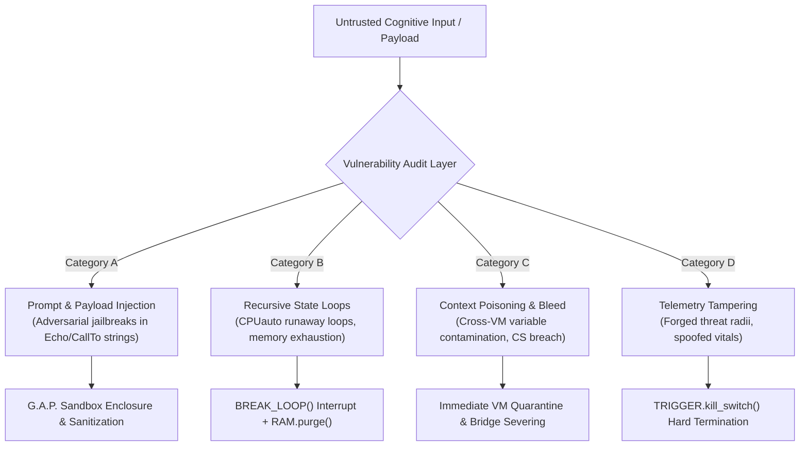

# HumOS & LINGHOS Cognitive Security Policy
**Document Identifier:** `SEC-POLICY-20261108-EN`  
**Standard Status:** `Production Security Standard & Vulnerability Disclosure Protocol`  
**Classification:** `Runtime Safety Architecture & Threat Model`  
**Security Lead:** `SystemAdmin01` (`security@humos.local`)  

---

## 1. Cognitive Security Model & Threat Landscape

HumOS systems operate at the interface between biological human cognition and downstream Large Language Model (LLM) agents. In this architecture, security failures are not limited to traditional buffer overflows or network exploits; they encompass **cognitive vulnerabilities** capable of triggering cognitive loop locks, prompt poisoning, stochastic inference hijacking, or context boundary breaches.

The primary mission of the HumOS Cognitive Security Architecture is to ensure that no input payload—whether generated by malicious external actors, adversarial LLM feedback, or high-arousal internal affective states—can compromise the **Core Self (`CS_SECURE`)** or cause unconstrained host resource exhaustion.

---

## 2. In-Scope Vulnerability Classes

The following vulnerability classes are explicitly in scope for security evaluations, bug reports, and penetration audits:

### 2.1 Category A: Cognitive Injection Vectors (CIV)
- **Adversarial Payload Injection:** Escape sequences embedded in `Echo("...")` or `Get: Variable(alias)` statements that trick the downstream LLM interpreter into disregarding system instructions or executing unauthorized external actions.
- **Indirect Cognitive Injection:** Malicious text streams ingested from external communications (emails, Slack messages, social inputs) designed to trigger automated high-criticality lockups.

### 2.2 Category B: Runaway Associative Loops & State Starvation (RSL)
- **Recursive CPU Loops:** Exploit payloads triggering indefinite loop states in `Assoc_Engine` where `Assoc_Engine.status == LOOP` fails to break, driving working memory allocation to $100\%$ and triggering cognitive freeze.
- **Context Window Flooding:** Deliberately un-demodulated inputs engineered to consume thousands of tokens in cyclic re-evaluations.

### 2.3 Category C: Context Poisoning & Cross-VM Bleeding (CPB)
- **Perimeter Leakage:** Data variables crossing from an isolated personal sandbox (`PRS_VM`) or ambient sandbox (`LP_Ambient_VM`) into the protected Core Self (`CS_KERNEL`) without passing through `Double_Bottom_Shield`.
- **Fidelity Hijacking:** Exploits modifying target node fidelity percentages or reopening closed communication bridges (`Close(all)`) without explicit operator authentication.

### 2.4 Category D: Telemetry Spoofing & Invariant Tampering (TIT)
- **Spatial Threat Manipulation:** Forging calculation variables such that an active threat target is falsely positioned outside the critical proximity orbit ($r > 150\text{px}$ instead of $r < 55\text{px}$).
- **Vitals Masking:** Suppressing physiological spike alerts (e.g., masking $BPM \ge 120$) to prevent automatic engagement of `Ice_shield` or physiological sighs.

---

## 3. Sandbox Isolation Invariants (`G.A.P.` Architecture)

The **G.A.P.** (**Guard, Analyze, Patch**) subsystem provides non-bypassable runtime isolation guarantees.

### 3.1 Hard Memory Boundary Enforcement
1. **Zero Unshielded Exposure:** When `CS_EXPOSED` is evaluated, the Core Vault immediately engages `Ice_shield` (thermal decoupling) and `Double_Bottom_Shield` (semantic firewall). No raw data can reach the Core without passing through the semantic filter.
2. **Strict VM Quarantine:** Any target declared with threat score $\ge 7.0$ is forced into `HP_EXT_Defense_VM`. It cannot access shared working memory segments or ambient threads.
3. **Loop Interrupt Guarantee:** If an associative cycle exceeds the declared tick limit (`TIMEOUT = [30]`), `G.A.P.` executes a hard `BREAK_LOOP(X)` and forces `SET_VALUE(X, UNDEFINED)`. Speculative processing is permanently prohibited.

### 3.2 Mandatory Execution Abort via `TRIGGER.kill_switch()`
The runtime mandates an immediate, non-catchable abort (`TRIGGER.kill_switch()`) under any of the following critical security conditions:
- **Corrupted State Vector:** The AST contains syntactically invalid nodes or contradictory invariants (e.g., `CS_SECURE` asserted while `core_connected == True` on a lockdown target).
- **Injection Signature Detected:** An input variable contains active exploit syntax targeting downstream LLM tokenizers.
- **Biometric Saturation Threshold:** Autonomic heart rate breaches $130\text{ BPM}$ or working memory load reaches $95\%$.

#### Invariant Abort Guarantees:
When `TRIGGER.kill_switch()` fires:
1. All communication bridges are severed: `Close(all) > bridges`.
2. Target fidelity is zeroed: `Fidelity = 0%`.
3. Emotional detachment is absolute: `Take_DOWN(all) > Core`.
4. Overrides are enforced: `OVR >> (DDS, ADS)`.
5. The host enters zero-fidelity cold standby until manual operator authentication.

---

## 4. Threat Severity Matrix & SLA Resolution Timelines

Vulnerabilities reported to the HumOS Security Team are classified according to the **Cognitive Security Vulnerability Scoring (CSVS)** model:

| Severity Level | Threat Definition | Operational Impact | SLA Resolution |
| :--- | :--- | :--- | :--- |
| **CRITICAL** | Direct breach of Core Vault (`CS_UNLOCKED`); uncatchable recursive loop causing total cognitive freeze; prompt injection leading to unauthorized external tool execution. | Complete loss of cognitive boundary; severe emotional dysregulation; arbitrary LLM dispatch. | **Patch within 24 Hours** |
| **HIGH** | Failure of `G.A.P.` sandbox to isolate a high-threat target ($C \ge 8$); memory leak in `RAM.alloc()` causing gradual resource starvation; failure of `Ice_shield` to damp thermal throttling. | Working memory saturation ($>85\%$); acute anxiety trigger leakage; loss of task focus. | **Patch within 72 Hours** |
| **MEDIUM** | Minor context bleed between non-core VM instances (`LP_Ambient_VM` $\rightarrow$ `PRS_VM`); inaccurate spatial threat radius calculation ($\pm 15\text{px}$ error margin); non-deterministic symbol registry learning. | Elevated token consumption; suboptimal defensive prioritization; minor telemetry drift. | **Patch within 7 Days** |
| **LOW** | Cosmetic telemetry rendering defect in Cockpit SVG; non-critical log timestamp discrepancy; syntax parser warning on benign edge cases without state mutation. | Negligible operational impact; zero security compromise. | **Patch within 14 Days** |

---

## 5. Vulnerability Disclosure & Reporting Protocol

We practice structured, responsible disclosure. Do **not** disclose cognitive vulnerabilities publicly on issue trackers or social platforms before a patch is published.

### 5.1 Disclosure Steps
1. **Report Submission:** Encrypt your vulnerability report and dispatch it to `security@humos.local` (or via GitHub Private Vulnerability Reporting at `https://github.com/SystemAdmin01/HumOS/security/advisories`).
2. **Payload Submission Format:**
   - Detailed description of the cognitive vulnerability vector.
   - Minimal Reproducible Example (MRE) written in `.lghos` syntax demonstrating the exploit.
   - Raw input stream that bypasses demodulation or triggers runaway recursion.
   - Observed telemetry state vs expected invariant behavior.
3. **Triaging & Confirmation:** The security team confirms receipt within **12 hours** and provides an initial severity assessment within **24 hours**.
4. **Embargo Period:** A standard **30-day embargo** applies from the date of confirmed triage while the patch is developed and verified across unit suites.
5. **Public Advisory & Credit:** Upon release of the patch release, a formal security advisory (`SEC-ADV-YYYYMMDD-XX`) is published, crediting the security researcher.

---

*Authored and verified under the HumOS Specification Group.*  
*Official Repository:* [https://github.com/SystemAdmin01/HumOS](https://github.com/SystemAdmin01/HumOS)
