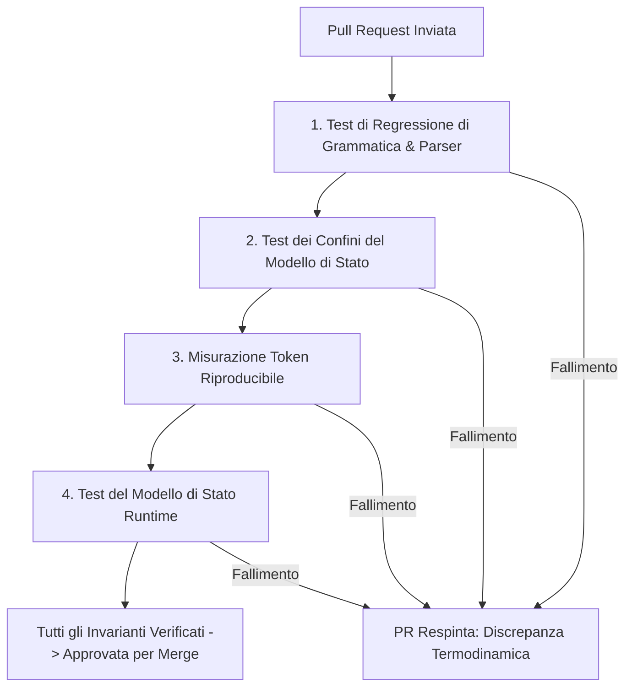

# Linee Guida per la Contribuzione a HumOS & LINGHOS
**Identificatore Documento:** `GOV-CONTRIB-20261108-IT`  
**Stato dello Standard:** `Specifica Ufficiale di Governance del Progetto`  
**Classificazione:** `Workflow per Sviluppatori Open-Source & Standard di Protocollo`  
**Maintainer:** `SystemAdmin01`  

---

## 1. Codice di Condotta Tecnica & Filosofia Architetturale

HumOS mira a un comportamento prevedibile e verificabile nel compilatore e nel modello di stato implementati. LINGHOS può fungere da rappresentazione intermedia compatta per applicazioni a valle basate su Large Language Model (LLM), ma il repository attuale non garantisce inferenze LLM deterministiche.

Ogni contributo — che si tratti di una patch al parser, di un potenziamento al cockpit visuale o di una revisione documentale — deve preservare tassativamente:
1. **Comportamento deterministico del compilatore:** A parità di sorgente e stato runtime, i percorsi di parsing e serializzazione supportati devono essere ripetibili e coperti da test.
2. **Budget del contesto misurato:** Ogni affermazione sull'efficienza in token deve indicare tokenizer, corpus e metodo di misura; non pubblicare percentuali non verificate.
3. **Limiti espliciti della simulazione:** RAM, BPM, VM e difese sono modelli applicativi finché non esistono controlli reali sull'host o integrazioni con sensori.

---

## 2. Protocollo di Proposta Primitivi (PPP)

Qualsiasi estensione al linguaggio LINGHOS, ai primitivi documentati o al comportamento d'esecuzione deve rispettare il **Protocollo di Proposta Primitivi**. La sintassi proposta deve essere distinta chiaramente dai comandi supportati dal runtime; il parser attuale è line-oriented e non costruisce un AST formale.

### 2.1 Criteri di Accettazione dei Primitivi
Prima di inviare una proposta per un nuovo primitivo (es. `MEMORY.*`, `THREAD.*`, `SHIELD.*`), l'autore deve dimostrare che:
1. **Non Ridondanza:** La funzionalità non può essere ottenuta componendo una sequenza di primitivi già esistenti (es. `RAM.alloc()` + `THREAD.spawn()`).
2. **Efficienza nel Context Window:** Riporta l'impronta di token indicando nome e versione del tokenizer. Applica l'obiettivo di 24 token solo quando tokenizer e corpus di misura sono specificati; UTF-8 non è di per sé un tokenizer BPE.
3. **Transizione di Stato Deterministica:** Il primitivo deve produrre una modifica di stato matematicamente dimostrabile nel modello di memoria runtime (es. deallocare RAM, limitare i BPM o modificare il raggio di minaccia).
4. **Compatibilità Retroattiva del Parser:** Aggiungi test di regressione per il comportamento supportato e per gli input malformati. Il parser attuale è scritto manualmente e non implementa LR(1).

### 2.2 Schema Formale RFC per Proposta Primitivi
Ogni proposta deve essere presentata tramite issue o pull request con riferimento a `docs/SPEC.md` utilizzando il seguente schema tecnico:

```markdown
### Specifica Primitivo: [DOMINIO].[identificatore]
- **Specifica Sintattica:** `Call >> [DOMINIO].[identificatore](<argomenti>);`
- **Arità & Tipi:** Tipi di parametro espliciti (es. `(target_id: Identificatore, limite: Intero)`).
- **Semantica di Memoria a Runtime:** Modifica concreta dello stato in `HumOSKernel` (es. impatto su RAM, registrazione thread).
- **Impatto sugli Invarianti Spaziali / Termodinamici:** Effetto diretto sul raggio di prossimità ($r$) o sul battito cardiaco ($BPM$).
- **Comportamento di Fallback & Eccezioni:** Codice di errore emesso in caso di anomalia (es. `ERR_BUFFER_OVERFLOW`).
- **Benchmark Token:** Conteggio token BPE per l'invocazione sintattica.
```

---

## 3. Standard di Verifica delle Pull Request (PRVS)

Ogni Pull Request (PR) deve superare una checklist di verifica manuale e automatica prima della revisione e del merge.



### 3.1 Checklist di Verifica Passo-Passo

- [ ] **1. Conformità Rigorosa a Grammatica & Lexer**
  - Gli esempi modificati o citati vengono verificati rispetto al sottoinsieme attualmente supportato da parser e compilatore.
  - I punti e virgola, le chiusure dei blocchi (`Main() { ... }`), le direttive (`/SET_Lockdown_Mode`) e gli header macro (`#include`) seguono rigorosamente la grammatica definita in `docs/SPEC.md`.
  - Nessuno spazio bianco superfluo a fine riga o delimitatori spezzati.

- [ ] **2. Verifica Isolamento Contesto (Zero Fuga di Prompt)**
  - I test devono verificare le associazioni target/VM modellate e prevenire mutazioni accidentali tra stati. Gli oggetti VM applicativi non devono essere descritti come isolamento a livello di sistema operativo.
  - La costruzione dei payload prompt deve delimitare i contenuti sorgente non fidati; la policy LLM a valle resta fuori dal perimetro di enforcement del runtime.

- [ ] **3. Benchmark dell'Impronta di Token**
  - Le affermazioni sui token devono includere corpus grezzo riproducibile, nome/versione del tokenizer, regole di serializzazione, misurazioni ripetute e risultati grezzi. Non imporre una riduzione dell'85% finché non è stato pubblicato un benchmark di riferimento.
  - Misura separatamente dimensione in byte e conteggio token: i byte non sono token.

- [ ] **4. Test Unitari degli Invarianti Termodinamici**
  - Test del modello: verificare che `Call >> Drop_All_Background_Threads;` produca la telemetria modellata documentata nell'implementazione corrente. Considerare `RAM.purge()` come parte della specifica finché non viene implementato.
  - Test del raggio spaziale: Verificare che il raggio di prossimità rispetti l'equazione $r = \max(50.0, 175.0 - (W \cdot 6.5 + C \cdot 5.5))$.
  - Test di clamp difensivo: Verificare che `Ice_shield` prevenga il thermal throttling quando la RAM supera l'$85\%$.

---

## 4. Standard dei Commit Convenzionali & Ambiti HumOS

I messaggi di commit devono aderire tassativamente alla specifica **Conventional Commits 1.0.0**. Messaggi disordinati o generici (es. `update code`, `fix stuff`) saranno bloccati dagli hook di controllo del repository.

### 4.1 Struttura del Commit
```text
<tipo>(<ambito>): <breve riassunto imperativo>

[corpo opzionale con motivazione tecnica]

[piede opzionale con riferimenti a issue o modifiche incompatibili]
```

### 4.2 Tipi Approvati & Ambiti Specifici HumOS

| Ambito | Descrizione | Tipi Consentiti | Esempio |
| :--- | :--- | :--- | :--- |
| `linghos` | Sintassi LINGHOS, scanner lessicale, comportamento di compilatore e parser | `feat`, `fix`, `refactor` | `feat(lghos): add THREAD.suspend opcode support` |
| `parser` | Compilazione AST, motore di parsing, normalizzazione istruzioni | `fix`, `perf`, `test` | `fix(parser): resolve lookahead stall on nested IF blocks` |
| `cockpit` | Interfaccia Web, canvas radar SVG interattivo, console HTML/JS | `feat`, `fix`, `style` | `feat(cockpit): render active defense labels on SVG perimeter` |
| `gap` | Modulo di sicurezza G.A.P., interrupt ricorsivi, kill-switch | `sec`, `fix`, `feat` | `sec(gap): enforce mandatory timeout on unclassified inputs` |
| `spec` | Documentazione formale, contratti del linguaggio, guide | `docs` | `docs(spec): document RAM.alloc memory invariants` |
| `storage` | Persistenza scenari locali, serializzazioni JSON, sessioni | `feat`, `fix`, `test` | `feat(storage): support custom symbol de-registration` |

### 4.3 Esempi di Messaggi di Commit

#### ✅ Messaggi di Commit Validi
```bash
feat(lghos): implement RAM.alloc buffer reservation syntax
fix(parser): prevent variable leakage across multi-VM declarations
sec(gap): force TRIGGER.kill_switch execution on heart rate breach
docs(spec): update Section 3 primitive matrix with arity contracts
```

#### ❌ Messaggi di Commit Non Validi
```bash
updated readme.md                 # Mancano tipo e ambito
fix bug in script                 # Ambito non standard, tono non imperativo
WIP: cockpit stuff                # Tag provvisorio inammissibile nella cronologia
feat: added things to parser      # Manca l'ambito, verbo al passato
```

---

## 5. Configurazione dell'Ambiente di Sviluppo & Validazione

Per testare i contributi in locale:

```bash
# 1. Clona il repository
git clone https://github.com/SystemAdmin01/HumOS.git
cd HumOS

# 2. Valida il compilatore e il motore di memorizzazione
python3 -c "
from src.linghos.compiler import LINGHOSCompiler
from src.linghos.storage import GLOBAL_STORAGE
compiler = LINGHOSCompiler()
res = compiler.compile('Main() { Call >> Ice_shield; <<@end }')
assert res['telemetry']['ice_shield'] is True
print('Verifica del compilatore superata con successo.')
"

# 3. Avvia l'istanza locale del Cockpit
python3 src/app.py
```

---

*Redatto sotto il Gruppo di Specifica HumOS.*  
*Repository Ufficiale:* [https://github.com/SystemAdmin01/HumOS](https://github.com/SystemAdmin01/HumOS)
