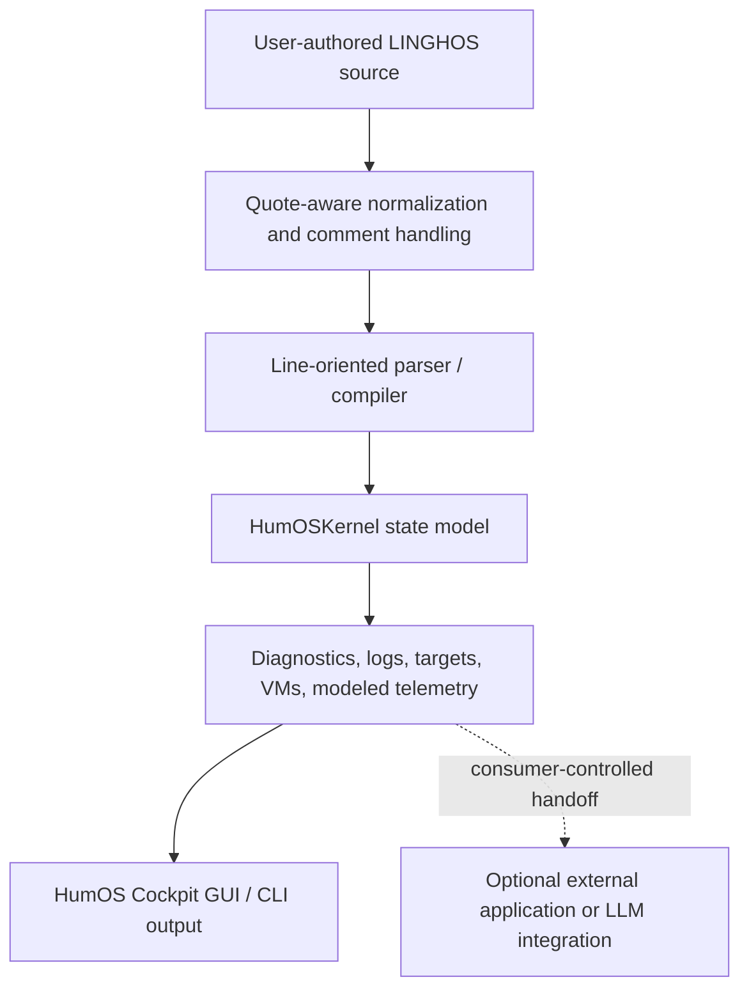

# HumOS & LINGHOS Developer Guide

**Package:** `linghos 1.0.0` · **Architecture specification:** `2.1.0-REV4` · **Minimum Python:** `3.8`

## 1. Purpose and scope

HumOS applies operating-system concepts to cognitive self-management. The repository ships a Python package, the LINGHOS compiler and line-oriented interpreter, an in-memory state model, local JSON persistence, a command-line interface, and the browser-based **HumOS Cockpit GUI**.

This guide describes the software that is present in the repository. The wider architecture in the specification and protocol documents includes design goals that are not runtime features yet.

> **Implementation boundary:** The shipped package does not automatically classify raw natural-language or emotional input, construct a formal AST, isolate operating-system processes or virtual machines, acquire biometric signals, enforce a G.A.P. loop watchdog, implement `RAM.purge()` or `TRIGGER.kill_switch()`, or call an external LLM. Runtime VM, RAM, BPM, and defense values are application-level models.

See the [implementation-status section in the specification](SPEC.md#13-implementation-status-and-conformance-boundary).

## 2. What runs today

The current local execution path is:



The compiler returns a structured result containing `compiler_meta`, `diagnostics`, modeled `telemetry`, target and VM records, solution steps, logs, and the symbol registry. The local Cockpit presents this result and provides visual editing and scenario workflows.

The compiler and CLI interpreter are separate line-oriented execution paths. They share lexical normalization and block scanning, but they are not a formal AST implementation and are not guaranteed to have identical behavior for every design-language construct.

## 3. Supported language subset

The following constructs have implementation paths in the current compiler and/or interpreter. Their exact behavior is defined by the code and regression tests, not by the broader design specification.

| Construct | Current role |
| :--- | :--- |
| `#include` | Register a named module with the kernel / symbol registry |
| `Get:` | Register targets, aliases, and weight values |
| `Set_CriticVal` | Set a target's criticality in the compiler path |
| `@Start>(...)` / `ON>` | Associate targets with an in-memory VM model |
| `Call >>` | Invoke a supported kernel skill/state action |
| `/SET_Lockdown_Mode` | Apply modeled lockdown state |
| `/SET_Attack_Mode` | Set the modeled attack mode |
| `Take_DOWN` / `Close` | Update modeled target connection and bridge state |
| `OVR >>` | Set modeled defense overrides |
| `BE>` | Set a modeled behavior label |
| `IF(...)` | Evaluate a supported kernel condition and process its block |
| `Echo(...)` | Write a message to the runtime log |
| `<<@end` | Record the script termination marker |

`Main()` acts as a source wrapper; it is not a function body compiled into an AST. Dotted design primitives such as `RAM.alloc()`, `THREAD.spawn()`, and `TRIGGER.kill_switch()` are not implemented as native runtime commands.

### Minimal example

```linghos
Get: Review(review)[6];
Set_CriticVal >> review = [7];

Main() {
    @Start>(HP_EXT_Defense_VM) {
        ON> review;
    }

    IF(CS_EXPOSED) {
        Call >> Ice_shield;
        Call >> Double_Bottom_Shield;
    }

    Echo("Review isolated in the modeled defense VM");
    <<@end
}
```

The numeric values and VM assignment above are inputs to HumOS's state model. They do not create an operating-system virtual machine or measure a person's physiological state.

## 4. Run the Cockpit

From the repository root:

```bash
python3 src/app.py
```

The application binds to loopback and prints the local URL, normally `http://127.0.0.1:8080`. Use the URL printed by the process if the default port is busy.

The browser GUI is implemented in [`src/linghos/cockpit.html`](../src/linghos/cockpit.html). It includes a LINGHOS editor, visual target/defense controls, modeled telemetry, symbol management, and scenario persistence.

The local HTTP service accepts JSON requests up to 1 MiB and checks browser request origin on POST. It does not authenticate local users or processes. Keep it on loopback; do not expose it through a public network interface, reverse proxy, or tunnel.

## 5. Use the command-line interface

From the package directory:

```bash
cd src
python3 -m linghos --help
python3 -m linghos run ../examples/adhd_ram_flush.lgh
python3 -m linghos repl
python3 -m linghos gui
```

The package can also be installed locally:

```bash
cd src
python3 -m pip install .
```

See [`src/README.md`](../src/README.md) for package-specific usage.

## 6. G.A.P. protocol and security boundaries

The English protocol identifies GAP-001 as **Active Paranoia Management**; the Italian protocol title is **Gestione Attiva delle Paranoie**. G.A.P. describes a cognitive containment and response model. The current runtime provides modeled target/VM states and selected defense actions, but it does not implement the documented watchdog, operating-system sandbox enforcement, or hard kill-switch.

Read the [Security Policy](../SECURITY.md), [Italian Security Policy](SECURITY_IT.md), and [G.A.P.-001 protocol](../protocols/en/GAP-001-protocol.md) before making security claims about the project.

## 7. LLM integration and benchmarks

The repository does not ship an LLM client or a complete raw-input-to-LLM pipeline. An external application may consume compiler output and choose to forward a serialized state to a model, with its own consent, privacy, validation, and safety controls.

There are no reproducible token-reduction, hallucination-rate, or end-to-end latency benchmarks in this repository. Any numeric figures should be treated as unverified estimates until a public corpus, tokenizer/model versions, measurement scripts, run counts, and raw results are available. Deterministic parsing does not make downstream LLM inference deterministic.

## 8. Test and build

From the repository root:

```bash
PYTHONPATH=src python3 -m unittest discover -s tests -v
python3 -m compileall -q src tests
```

Build the Python package:

```bash
cd src
python3 -m pip wheel . --no-deps
```

GitHub Actions runs the regression suite across the declared Python support matrix and builds the package. The local commands above are the same basic checks used for contributions.

## 9. Related documentation

- [Root README](../README.md) — overview and quick start.
- [LINGHOS specification](SPEC.md) · [Specifiche LINGHOS in italiano](SPEC_IT.md).
- [Italian developer guide](GUIDE_IT.md).
- [English LINGHOS language notes](en/LINGHOS.md) · [Italian LINGHOS language notes](it/LINGHOS.md).
- [Contribution guidelines](../CONTRIBUTING.md) · [Linee guida italiane](CONTRIBUTING_IT.md).
