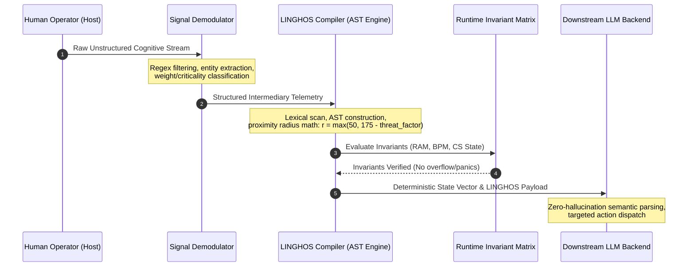

# HumOS & LINGHOS Developer Implementation Guide
**Document Identifier:** `DOC-GUIDE-20261108-EN`  
**Revision:** `2.1.0-STAGING`  
**Classification:** `Technical Implementation Standard & Reference Integration Manual`  
**Maintainer:** `SystemAdmin01`  

---

> [!IMPORTANT]
> **ACTIVE STAGING SPECIFICATION NOTICE**  
> LINGHOS (**Language for Interfacing Neurodivergent Gestalt Human Operating Systems**) is an evolving, active specification. This implementation guide operates as a **live staging environment** where experimental directives, lexical expansions, dynamic AST abstractions, and compiler pipeline optimizations are developed, validated, and documented prior to formal core freezing. Implementers must adhere to the data-contract invariants defined herein to guarantee backward and forward execution compatibility.

---

## 1. Architectural Philosophy & Developer Primitives

Modern computational cognitive interfaces face a critical bottleneck: **the high-entropy nature of raw human affective streams**. When an individual experiences ADHD overwhelm, sensory hyper-arousal, or recursive cognitive looping, the resulting text stream exhibits high token redundancy, conversational fluff, and ambiguous entity relationships.

Feeding raw affective prose directly into downstream reasoning systems (such as Large Language Model agents) introduces three catastrophic failure modes:
1. **Context Window Satiation:** Multi-paragraph emotional vents consume thousands of tokens on circular restatements, exhausting working context.
2. **Stochastic Drift & Hallucination:** Ambiguous emotional expressions cause the model's probabilistic attention mechanisms to latch onto hyper-dramatic metaphors rather than actionable state variables.
3. **Absence of Verifiable Invariants:** Natural language prompts cannot guarantee that boundaries (e.g., disconnecting from a toxic variable or enforcing physiological clamps) are deterministically executed.

LINGHOS resolves these vulnerabilities by acting as an **intermediate deterministic representation (IR)**. It compiles human cognitive states into a formal grammar that guarantees strict encapsulation, spatial boundary math, and explicit thermodynamic metrics.

---

## 2. Ingestion Pipeline Walkthrough: From Raw Vent to LINGHOS State Vector

The following four-step workflow describes the intended integration architecture. In the current repository, the shipped compiler accepts LINGHOS source; automatic extraction of targets, urgency, RAM, or BPM from free text is not implemented.



### Step 1: Raw Capture (Ingestion)
The operator inputs an unedited, high-entropy mental vent through a terminal, audio-transcription buffer, or input card.

```text
"Everything is blowing up right now. Mark keeps pinging me about the Q3 infrastructure review, Sarah is complaining that the database migration failed, and I can hear my pulse in my ears. I feel like if I don't reply in five seconds my career is over. I cannot think straight and I have twelve tasks open at once."
```

### Step 2: Signal Demodulation & Entity Extraction
The demodulator passes the raw stream through a regular-expression filter and syntactic entity classifier:
1. **Identify Human Targets:** 
   - `Mark` $\rightarrow$ Alias: `mrk`, Type: Interpersonal Task Source.
   - `Sarah` $\rightarrow$ Alias: `srh`, Type: Critical Incident Source.
2. **Assign Weight & Criticality:**
   - `Mark`: Emotional Weight = `7/10`, Criticality = `6/10`.
   - `Sarah`: Emotional Weight = `8/10`, Criticality = `9/10`.
3. **Extract Physiological & RAM Markers:**
   - "Hear pulse in ears" $\rightarrow$ `BPM >= 120`.
   - "Twelve tasks open at once" $\rightarrow$ `RAM_LOAD >= 90%`.

### Step 3: Formal LINGHOS Script Synthesis
The extracted parameters are formatted into a deterministic `.lghos` architectural script:

```linghos
// ==============================================================================
// COMPILED INGESTION VIRTUAL SCRIPT
// ==============================================================================
#include <Defense_Mode>
#include <Executive_Control>
#include <Hardware_Regulation>
#include <Lghos.command>

Get: Mark(mrk)[7], Sarah(srh)[8];
Set_CriticVal >> mrk = [6]
Set_CriticVal >> srh = [9]

LP = low priority
HP = High priority

Main() {
    // Stage 1: Purge saturated volatile RAM
    Call >> RAM.purge();
    Call >> Drop_All_Background_Threads;

    // Stage 2: Sandboxing high-threat variables
    @Start>(HP_EXT_Defense_VM) {
        priority = HP;
        ON> mrk, srh;
    }

    // Stage 3: Perimeter defenses
    IF(CS_EXPOSED) {
        Call >> Ice_shield;
        Call >> Double_Bottom_Shield;
        OVR >> (DDS, ADS);
    }

    // Stage 4: Hardware clamp
    Execute >> Physiological_Sigh(Rapporto_4_7_8);

    // Stage 5: Focus pinning
    Call >> RAM.alloc(DB_MIGRATION_FOCUS, 256MB);
    Call >> THREAD.spawn(TH_DB_TRIAGE, srh, HP);

    <<@end
}
```

### Step 4: Verification of State Invariants
Before routing to downstream execution, the runtime evaluates spatial and thermodynamic equations:
- **Spatial Threat Proximity:**
  $$\text{threat\_factor}(srh) = (8 \cdot 6.5) + (9 \cdot 5.5) = 52.0 + 49.5 = 101.5$$
  $$\text{radius}(srh) = \max(50.0, 175.0 - 101.5) = 73.5\text{ px}$$
- **Thermodynamic Invariants:**
  - `RAM %` before purge: `92%` $\rightarrow$ After `RAM.purge()`: `22%`.
  - `BPM`: `124` $\rightarrow$ With `Ice_shield` active: clamped to nominal descent ($\approx 75$).
  - `CS_STATE`: Verified as `SECURE` (Core Vault isolated by `Double_Bottom_Shield`).

---

## 3. LLM Context Injection Pattern

This section shows an optional downstream integration pattern. The repository builds compiler output and includes an illustrative prompt-injection harness, but it does not ship an LLM API client or execute external model calls. Prompt instructions cannot guarantee deterministic or hallucination-free model responses.

### 3.1 Token Optimization Metrics

| Metric | Raw Natural-Language Input | Serialized LINGHOS State | Evidence Status |
| :--- | :--- | :--- | :--- |
| **Input token count** | Depends on sample and tokenizer | Depends on extracted fields and syntax | **Not benchmarked in this repository** |
| **Semantic drift** | Depends on model, prompt, and context | Compiler-side parsing is rule-based for the implemented subset | **No comparative hallucination-rate study** |
| **Context footprint** | Depends on input length | Can be shorter for compact, pre-structured state | **No fixed reduction guarantee** |
| **End-to-end latency** | Includes model and network latency | Compiler timing is reported locally; LLM dispatch is not bundled | **No comparable latency benchmark** |

To publish numeric performance claims, add a reproducible corpus, tokenizer/model versions, measurement scripts, run counts, and raw results. A deterministic compiler representation does not make probabilistic LLM output deterministic.

### 3.2 Illustrative Python Integration Harness

The following dependency-free example demonstrates a heuristic integration sketch. It is not a validated NLP or biometric signal processor, and its generated commands include specification-level primitives that the current runtime does not implement:

```python
"""
HumOS Engine: LINGHOS Context Injection Harness.
Author: SystemAdmin01
Target: Production LLM Runtime Integration
"""

import json
import re
from typing import Dict, Any, List


class CognitiveDemodulator:
    """Demodulates unstructured natural language into structured signal parameters."""
    
    @staticmethod
    def extract_state(raw_text: str) -> Dict[str, Any]:
        targets: List[Dict[str, Any]] = []
        
        # Detect high-arousal names or entities with heuristic urgency
        words = re.findall(r'\b[A-Z][a-z]+\b', raw_text)
        known_entities = [w for w in words if w not in {"I", "The", "Everything", "My", "When"}]
        
        for idx, ent in enumerate(known_entities[:3]):
            targets.append({
                "name": ent,
                "alias": ent[:3].lower(),
                "weight": 7 + (idx % 3),
                "criticality": 6 + (idx % 4)
            })
            
        # Detect physiological markers
        has_pulse = bool(re.search(r'\b(pulse|heart|bpm|pounding|chest)\b', raw_text, re.I))
        has_multitask = bool(re.search(r'\b(twelve|tasks|tabs|everything|swamped)\b', raw_text, re.I))
        
        return {
            "targets": targets,
            "estimated_bpm": 128 if has_pulse else 72,
            "estimated_ram": 94 if has_multitask else 35,
            "cs_exposed": has_pulse or has_multitask
        }


class LinghosCompilerBridge:
    """Translates demodulated signal state into a concrete LINGHOS state vector."""
    
    @staticmethod
    def compile_payload(state: Dict[str, Any]) -> Dict[str, Any]:
        targets = state.get("targets", [])
        
        target_lines = [f"{t['name']}({t['alias']})[{t['weight']}]" for t in targets]
        target_decl = f"Get: {', '.join(target_lines)};" if target_lines else "// No external targets declared."
        
        critic_lines = [f"Set_CriticVal >> {t['alias']} = [{t['criticality']}]" for t in targets]
        critic_decl = "\n".join(critic_lines)
        
        # Calculate spatial proximity for each target
        proximity_vectors = {}
        for t in targets:
            threat_factor = (t['weight'] * 6.5) + (t['criticality'] * 5.5)
            radius = max(50.0, 175.0 - threat_factor)
            proximity_vectors[t['alias']] = {
                "name": t['name'],
                "radius_px": round(radius, 1),
                "threat_score": round((t['weight'] * 0.4) + (t['criticality'] * 0.6), 2)
            }
            
        linghos_script = f"""#include <Defense_Mode>
#include <Executive_Control>
#include <Hardware_Regulation>
#include <Lghos.command>

{target_decl}
{critic_decl}

LP = low priority
HP = High priority

Main() {{
    Call >> RAM.purge();
    Call >> Drop_All_Background_Threads;
    @Start>(HP_EXT_Defense_VM) {{
        priority = HP;
        ON> {', '.join(t['alias'] for t in targets)};
    }}
    IF(CS_EXPOSED) {{
        Call >> Ice_shield;
        Call >> Double_Bottom_Shield;
        OVR >> (DDS, ADS);
    }}
    Execute >> Physiological_Sigh(Rapporto_4_7_8);
    <<@end
}}"""

        return {
            "linghos_code": linghos_script,
            "proximity_vectors": proximity_vectors,
            "telemetry": {
                "ram_usage_pct": 20,  # post-purge nominal invariant
                "heart_rate_bpm": 74,  # clamped nominal invariant
                "cs_state": "SECURE",
                "active_shields": ["Ice_shield", "Double_Bottom_Shield", "DDS_ADS_Override"]
            }
        }


class LLMPromptInjector:
    """Builds hardened, zero-drift system prompts from compiled LINGHOS vectors."""
    
    SYSTEM_TEMPLATE = """You are the HumOS Autonomous Execution Kernel.
You do not engage in therapeutic, conversational, or emotional discourse.
You consume compiled LINGHOS state vectors and execute deterministic, structured actions.

[MANDATORY OPERATIONAL INVARIANTS]
1. Core Self status is {cs_state}. You must maintain strict boundary isolation.
2. Mental RAM is clamped to {ram_pct}%. Prohibit opening multi-task threads.
3. Active shields engaged: {active_shields}.
4. Target Proximity Matrix:
{target_matrix}

[INCOMING LINGHOS STATE VECTOR]
```linghos
{linghos_script}
```

[OUTPUT CONTRACT]
You must respond exclusively with a valid JSON object matching this schema:
{{
  "action_status": "LOCKED | EXECUTING | CLAMPED",
  "isolated_targets": ["target_alias_list"],
  "atomic_immediate_task": "Concise non-divisible directive",
  "boundary_statement": "Firm, cold message to deliver externally if contact required",
  "system_telemetry_post_eval": {{
    "ram_pct": {ram_pct},
    "cs_state": "{cs_state}"
  }}
}}"""

    @classmethod
    def generate_messages(cls, compiled_data: Dict[str, Any]) -> List[Dict[str, str]]:
        telemetry = compiled_data["telemetry"]
        prox = json.dumps(compiled_data["proximity_vectors"], indent=2)
        
        system_content = cls.SYSTEM_TEMPLATE.format(
            cs_state=telemetry["cs_state"],
            ram_pct=telemetry["ram_usage_pct"],
            active_shields=", ".join(telemetry["active_shields"]),
            target_matrix=prox,
            linghos_script=compiled_data["linghos_code"]
        )
        
        return [
            {"role": "system", "content": system_content},
            {"role": "user", "content": "EXECUTE LINGHOS DISPATCH."}
        ]


# ==============================================================================
# EXECUTION VERIFICATION SUITE
# ==============================================================================
if __name__ == "__main__":
    sample_raw_input = (
        "Mark is spamming me about deadlines, Sarah said the migration is broken, "
        "and my pulse is pounding. I have twelve open problems in my head right now."
    )
    
    # 1. Demodulate
    raw_state = CognitiveDemodulator.extract_state(sample_raw_input)
    
    # 2. Compile to LINGHOS
    compiled = LinghosCompilerBridge.compile_payload(raw_state)
    
    # 3. Generate LLM Payload
    messages = LLMPromptInjector.generate_messages(compiled)
    
    print("=== INJECTED LLM SYSTEM PROMPT ===")
    print(messages[0]["content"])
    print("\n=== PAYLOAD VALIDATION SUCCESSFUL ===")
```

---

## 4. Reference Implementation Directory Structure

When authoring or integrating `.lghos` scripts into your codebase, follow this verified repository hierarchy:

```text
HumOS/
├── docs/
│   ├── SPEC.md                    # Core Architectural Formal Specification (EN)
│   ├── SPEC_IT.md                 # Core Architectural Formal Specification (IT)
│   ├── GUIDE.md                   # Developer Implementation & Injection Guide (EN)
│   └── GUIDE_IT.md                # Developer Implementation & Injection Guide (IT)
├── examples/
│   ├── 01_loop_isolation.lghos    # Reference script: G.A.P. Sandbox & Paranoia Breaker
│   ├── 02_ram_dump.lghos          # Reference script: RAM.purge() & Focus Pinning
│   ├── adhd_ram_flush.lgh         # Standalone quick-flush utility
│   └── incident_01.lgh            # Multi-vector defense simulation
└── src/
    ├── app.py                     # Execution entrypoint
    └── linghos/                   # Compiler, Kernel, Web & Storage Modules
```

---

*Authored under the HumOS Specification Group.*  
*Official Repository:* [https://github.com/SystemAdmin01/HumOS](https://github.com/SystemAdmin01/HumOS)
