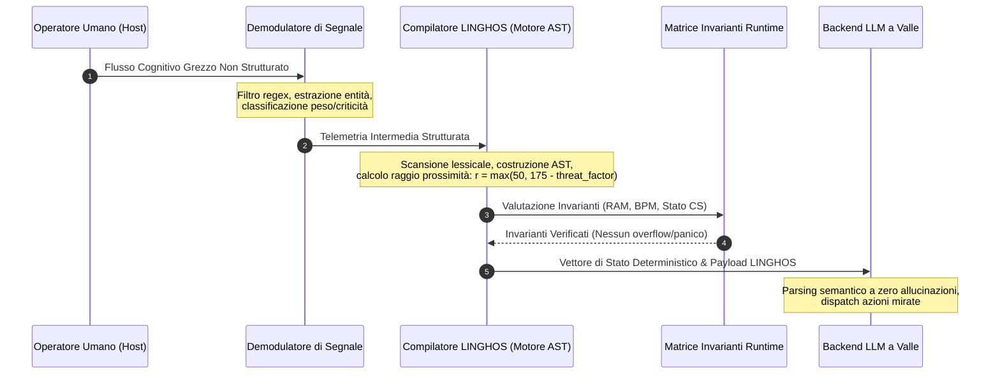

# Guida all'Implementazione per Sviluppatori HumOS & LINGHOS
**Identificatore Documento:** `DOC-GUIDE-20261108-IT`  
**Revisione:** `2.1.0-STAGING`  
**Classificazione:** `Standard Tecnico d'Implementazione & Manuale di Integrazione di Riferimento`  
**Maintainer:** `SystemAdmin01`  

---

> [!IMPORTANT]
> **AVVISO DI SPECIFICA IN STAGING ATTIVO**  
> LINGHOS (**Language for Interfacing Neurodivergent Gestalt Human Operating Systems**) è una specifica attiva in costante evoluzione. Questa guida per sviluppatori opera come un **ambiente di staging permanente** in cui direttive sperimentali, espansioni lessicali, astrazioni AST dinamiche e ottimizzazioni della pipeline del compilatore vengono sviluppate, validate e documentate prima del congelamento formale del core. Gli sviluppatori sono tenuti a rispettare gli invarianti contrattuali qui definiti per garantire la piena compatibilità di esecuzione presente e futura.

---

## 1. Filosofia Architetturale & Primitivi di Sviluppo

Le moderne interfacce computazionali cognitive affrontano un collo di bottiglia critico: **l'elevata entropia dei flussi emotivi umani grezzi**. Quando un individuo attraversa sovraccarico da ADHD, iper-eccitazione sensoriale o loop cognitivi ricorsivi, il flusso di testo risultante manifesta un'altissima ridondanza di token, divagazioni conversazionali e relazioni ambigue tra le entità.

Inviare direttamente prosa emotiva non strutturata ai sistemi di ragionamento a valle (come gli agenti basati su Large Language Model) introduce tre modalità di fallimento catastrofiche:
1. **Saturazione del Context Window:** Sfoghi emotivi su più paragrafi consumano migliaia di token in riformulazioni circolari, esaurendo la memoria di lavoro utile del modello.
2. **Deriva Stocastica & Allucinazione:** Espressioni emotive ambigue inducono i meccanismi di attenzione probabilistica del modello a focalizzarsi su metafore drammatiche anziché su variabili di stato azionabili.
3. **Assenza di Invarianti Verificabili:** I prompt in linguaggio naturale non possono garantire che i confini (es. disconnettersi da una variabile tossica o applicare clamp fisiologici) vengano eseguiti in modo deterministico.

LINGHOS risolve queste criticità operando come una **rappresentazione deterministica intermedia (IR)**. Compila gli stati cognitivi umani in una grammatica formale che assicura un incapsulamento rigoroso, il calcolo matematico della prossimità spaziale e metriche termodinamiche esplicite.

---

## 2. Guida della Pipeline di Ingestione: Dallo Sfogo Grezzo al Vettore di Stato LINGHOS

Il seguente workflow in quattro passaggi descrive l'architettura d'integrazione prevista. Nel repository attuale, il compilatore distribuito accetta codice sorgente LINGHOS: l'estrazione automatica di target, urgenza, RAM o BPM dal testo libero non è implementata.



### Passo 1: Ingestione Grezza
L'operatore inserisce uno sfogo mentale grezzo e ad alta entropia tramite terminale, buffer di trascrizione vocale o scheda di input.

```text
"Sta crollando tutto adesso. Marco continua a scrivermi su Slack per la revisione dell'infrastruttura Q3, Sara si lamenta che la migrazione del database è fallita e sento il battito nelle orecchie. Mi sembra che se non rispondo entro cinque secondi la mia carriera sia finita. Non riesco a pensare lucidamente e ho dodici task aperti contemporaneamente."
```

### Passo 2: Demodulazione Segnale-Rumore & Estrazione Entità
Il demodulatore fa passare il testo grezzo attraverso un filtro basato su espressioni regolari e un classificatore sintattico di entità:
1. **Identificazione Target Umani:** 
   - `Marco` $\rightarrow$ Alias: `mrk`, Tipo: Sorgente Task Interpersonale.
   - `Sara` $\rightarrow$ Alias: `srh`, Tipo: Sorgente Incidente Critico.
2. **Assegnazione Peso Emotivo & Criticità:**
   - `Marco`: Peso Emotivo = `7/10`, Criticità = `6/10`.
   - `Sara`: Peso Emotivo = `8/10`, Criticità = `9/10`.
3. **Rilevamento Marcatori Fisiologici & RAM:**
   - "Sento battito nelle orecchie" $\rightarrow$ `BPM >= 120`.
   - "Dodici task aperti contemporaneamente" $\rightarrow$ `RAM_LOAD >= 90%`.

### Passo 3: Sintesi Formale dello Script LINGHOS
I parametri estratti vengono impaginati in uno script architetturale deterministico `.lghos`:

```linghos
// ==============================================================================
// SCRIPT VIRTUALE COMPILATO DA INGESTIONE
// ==============================================================================
#include <Defense_Mode>
#include <Executive_Control>
#include <Hardware_Regulation>
#include <Lghos.command>

Get: Marco(mrk)[7], Sara(srh)[8];
Set_CriticVal >> mrk = [6]
Set_CriticVal >> srh = [9]

LP = low priority
HP = High priority

Main() {
    // Stadio 1: Purga della RAM volatile satura
    Call >> RAM.purge();
    Call >> Drop_All_Background_Threads;

    // Stadio 2: Sandboxing delle variabili ad alta minaccia
    @Start>(HP_EXT_Defense_VM) {
        priority = HP;
        ON> mrk, srh;
    }

    // Stadio 3: Difese perimetrali
    IF(CS_EXPOSED) {
        Call >> Ice_shield;
        Call >> Double_Bottom_Shield;
        OVR >> (DDS, ADS);
    }

    // Stadio 4: Clamp fisiologico
    Execute >> Physiological_Sigh(Rapporto_4_7_8);

    // Stadio 5: Blocco del focus atomico
    Call >> RAM.alloc(DB_MIGRATION_FOCUS, 256MB);
    Call >> THREAD.spawn(TH_DB_TRIAGE, srh, HP);

    <<@end
}
```

### Passo 4: Verifica degli Invarianti di Stato
Prima di inviare il payload all'esecuzione a valle, il runtime valuta le equazioni spaziali e termodinamiche:
- **Prossimità Spaziale della Minaccia:**
  $$\text{threat\_factor}(srh) = (8 \cdot 6.5) + (9 \cdot 5.5) = 52.0 + 49.5 = 101.5$$
  $$\text{radius}(srh) = \max(50.0, 175.0 - 101.5) = 73.5\text{ px}$$
- **Invarianti Termodinamici:**
  - `RAM %` pre-purge: `92%` $\rightarrow$ Post `RAM.purge()`: `22%`.
  - `BPM`: `124` $\rightarrow$ Con `Ice_shield` attivo: stabilizzato verso discesa nominale ($\approx 75$).
  - `CS_STATE`: Verificato come `SECURE` (Core Vault isolato da `Double_Bottom_Shield`).

---

## 3. Pattern di Iniezione del Contesto negli LLM

Questa sezione mostra un possibile schema d'integrazione a valle. Il repository produce l'output del compilatore e include un harness illustrativo per costruire un prompt, ma non distribuisce un client API LLM né esegue chiamate a modelli esterni. Le istruzioni nel prompt non possono garantire risposte del modello deterministiche o prive di allucinazioni.

### 3.1 Metriche di Ottimizzazione dei Token

| Metrica | Input grezzo in linguaggio naturale | Stato LINGHOS serializzato | Stato delle evidenze |
| :--- | :--- | :--- | :--- |
| **Conteggio token** | Dipende dal campione e dal tokenizer | Dipende dai campi estratti e dalla sintassi | **Non misurato in questo repository** |
| **Deriva semantica** | Dipende da modello, prompt e contesto | Il parsing del compilatore è basato su regole per il sottoinsieme implementato | **Nessuno studio comparativo sul tasso di allucinazione** |
| **Impronta del contesto** | Dipende dalla lunghezza dell'input | Può essere inferiore per uno stato compatto e pre-strutturato | **Nessuna percentuale di riduzione garantita** |
| **Latenza end-to-end** | Include latenza del modello e della rete | Il compilatore misura il tempo locale; il dispatch LLM non è incluso | **Nessun benchmark di latenza comparabile** |

Per pubblicare valori numerici servono un corpus riproducibile, versioni del tokenizer/modello, script di misurazione, numero di esecuzioni e risultati grezzi. Una rappresentazione deterministica del compilatore non rende deterministica l'uscita probabilistica di un LLM.

### 3.2 Harness Illustrativo di Integrazione Python

Il seguente esempio Python autonomo mostra uno schema euristico d'integrazione. Non è un processore NLP o biometrico validato e il codice generato include primitivi descritti dalla specifica che il runtime attuale non implementa:

```python
"""
HumOS Engine: Harness di Iniezione del Contesto LINGHOS.
Autore: SystemAdmin01
Target: Integrazione Runtime LLM di Produzione
"""

import json
import re
from typing import Dict, Any, List


class CognitiveDemodulator:
    """Demodula il linguaggio naturale non strutturato in parametri di segnale precisi."""
    
    @staticmethod
    def extract_state(raw_text: str) -> Dict[str, Any]:
        targets: List[Dict[str, Any]] = []
        
        # Individua entità o nomi ad alta attivazione tramite euristica
        words = re.findall(r'\b[A-Z][a-z]+\b', raw_text)
        known_entities = [w for w in words if w not in {"Io", "Il", "La", "Tutto", "Mio", "Quando"}]
        
        for idx, ent in enumerate(known_entities[:3]):
            targets.append({
                "name": ent,
                "alias": ent[:3].lower(),
                "weight": 7 + (idx % 3),
                "criticality": 6 + (idx % 4)
            })
            
        # Rileva marcatori fisiologici
        has_pulse = bool(re.search(r'\b(battito|cuore|bpm|palpitazioni|petto)\b', raw_text, re.I))
        has_multitask = bool(re.search(r'\b(dodici|task|schede|aperti|sommerso|tutto)\b', raw_text, re.I))
        
        return {
            "targets": targets,
            "estimated_bpm": 128 if has_pulse else 72,
            "estimated_ram": 94 if has_multitask else 35,
            "cs_exposed": has_pulse or has_multitask
        }


class LinghosCompilerBridge:
    """Traduce lo stato del segnale demodulato in un vettore di stato LINGHOS concreto."""
    
    @staticmethod
    def compile_payload(state: Dict[str, Any]) -> Dict[str, Any]:
        targets = state.get("targets", [])
        
        target_lines = [f"{t['name']}({t['alias']})[{t['weight']}]" for t in targets]
        target_decl = f"Get: {', '.join(target_lines)};" if target_lines else "// Nessun target esterno dichiarato."
        
        critic_lines = [f"Set_CriticVal >> {t['alias']} = [{t['criticality']}]" for t in targets]
        critic_decl = "\n".join(critic_lines)
        
        # Calcola la prossimità spaziale per ogni target
        proximity_vectors = {}
        for t in targets:
            threat_factor = (t['weight'] * 6.5) + (t['criticality'] * 5.5)
            radius = max(50.0, 175.0 - threat_factor)
            proximity_vectors[t['alias']] = {
                "name": t['name'],
                "radius_px": round(radius, 1),
                "threat_score": round((t['weight'] * 0.4) + (t['criticality'] * 0.6), 2)
            }
            
        linghos_script = f"""#include <Defense_Mode>
#include <Executive_Control>
#include <Hardware_Regulation>
#include <Lghos.command>

{target_decl}
{critic_decl}

LP = low priority
HP = High priority

Main() {{
    Call >> RAM.purge();
    Call >> Drop_All_Background_Threads;
    @Start>(HP_EXT_Defense_VM) {{
        priority = HP;
        ON> {', '.join(t['alias'] for t in targets)};
    }}
    IF(CS_EXPOSED) {{
        Call >> Ice_shield;
        Call >> Double_Bottom_Shield;
        OVR >> (DDS, ADS);
    }}
    Execute >> Physiological_Sigh(Rapporto_4_7_8);
    <<@end
}}"""

        return {
            "linghos_code": linghos_script,
            "proximity_vectors": proximity_vectors,
            "telemetry": {
                "ram_usage_pct": 20,  # invariante nominale post-purge
                "heart_rate_bpm": 74,  # invariante nominale clampato
                "cs_state": "SECURE",
                "active_shields": ["Ice_shield", "Double_Bottom_Shield", "DDS_ADS_Override"]
            }
        }


class LLMPromptInjector:
    """Costruisce system prompt corazzati e privi di allucinazioni a partire dai vettori LINGHOS."""
    
    SYSTEM_TEMPLATE = """Sei il Kernel di Esecuzione Autonoma di HumOS.
Non impegnarti in dialoghi terapeutici, conversazionali o emotivi.
Consumi vettori di stato compilati in LINGHOS ed esegui azioni deterministiche e strutturate.

[INVARIANTI OPERATIVI OBBLIGATORI]
1. Lo stato del Core Self è {cs_state}. Devi mantenere un isolamento perimetrale rigoroso.
2. La RAM mentale è vincolata al {ram_pct}%. È vietato aprire thread multi-task.
3. Barriere difensive attive: {active_shields}.
4. Matrice di Prossimità dei Target:
{target_matrix}

[VETTORE DI STATO LINGHOS IN ENTRATA]
```linghos
{linghos_script}
```

[CONTRATTO DI OUTPUT]
Devi rispondere esclusivamente con un oggetto JSON valido conforme a questo schema:
{{
  "action_status": "LOCKED | EXECUTING | CLAMPED",
  "isolated_targets": ["lista_alias_target"],
  "atomic_immediate_task": "Direttiva atomica concisa non divisibile",
  "boundary_statement": "Dichiarazione ferma e distaccata da trasmettere esternamente in caso di contatto",
  "system_telemetry_post_eval": {{
    "ram_pct": {ram_pct},
    "cs_state": "{cs_state}"
  }}
}}"""

    @classmethod
    def generate_messages(cls, compiled_data: Dict[str, Any]) -> List[Dict[str, str]]:
        telemetry = compiled_data["telemetry"]
        prox = json.dumps(compiled_data["proximity_vectors"], indent=2, ensure_ascii=False)
        
        system_content = cls.SYSTEM_TEMPLATE.format(
            cs_state=telemetry["cs_state"],
            ram_pct=telemetry["ram_usage_pct"],
            active_shields=", ".join(telemetry["active_shields"]),
            target_matrix=prox,
            linghos_script=compiled_data["linghos_code"]
        )
        
        return [
            {"role": "system", "content": system_content},
            {"role": "user", "content": "ESEGUI DISPATCH LINGHOS."}
        ]


# ==============================================================================
# SUITE DI VERIFICA DELL'ESECUZIONE
# ==============================================================================
if __name__ == "__main__":
    sample_raw_input = (
        "Marco mi sta tempestando per le scadenze, Sara dice che la migrazione è bloccata, "
        "e sento il cuore battere forte. Ho dodici problemi aperti in testa in questo momento."
    )
    
    # 1. Demodulazione
    raw_state = CognitiveDemodulator.extract_state(sample_raw_input)
    
    # 2. Compilazione in LINGHOS
    compiled = LinghosCompilerBridge.compile_payload(raw_state)
    
    # 3. Generazione Payload LLM
    messages = LLMPromptInjector.generate_messages(compiled)
    
    print("=== SYSTEM PROMPT LLM INIETTATO ===")
    print(messages[0]["content"])
    print("\n=== VALIDAZIONE PAYLOAD COMPLETATA CON SUCCESSO ===")
```

---

## 4. Struttura delle Directory di Riferimento

Nell'integrare gli script `.lghos` nel tuo progetto, mantieni la seguente struttura gerarchica verificata:

```text
HumOS/
├── docs/
│   ├── SPEC.md                    # Specifica Architetturale Formale Core (EN)
│   ├── SPEC_IT.md                 # Specifica Architetturale Formale Core (IT)
│   ├── GUIDE.md                   # Guida Sviluppatori & Pattern Iniezione (EN)
│   └── GUIDE_IT.md                # Guida Sviluppatori & Pattern Iniezione (IT)
├── examples/
│   ├── 01_loop_isolation.lghos    # Script di riferimento: G.A.P. Sandbox & Loop Break
│   ├── 02_ram_dump.lghos          # Script di riferimento: RAM.purge() & Focus Atomico
│   ├── adhd_ram_flush.lgh         # Script autonomo di flush rapido
│   └── incident_01.lgh            # Simulazione difensiva multi-vettore
└── src/
    ├── app.py                     # Entrypoint di esecuzione
    └── linghos/                   # Moduli Compilatore, Kernel, Web & Storage
```

---

*Redatto sotto il Gruppo di Specifica HumOS.*  
*Repository Ufficiale:* [https://github.com/SystemAdmin01/HumOS](https://github.com/SystemAdmin01/HumOS)
