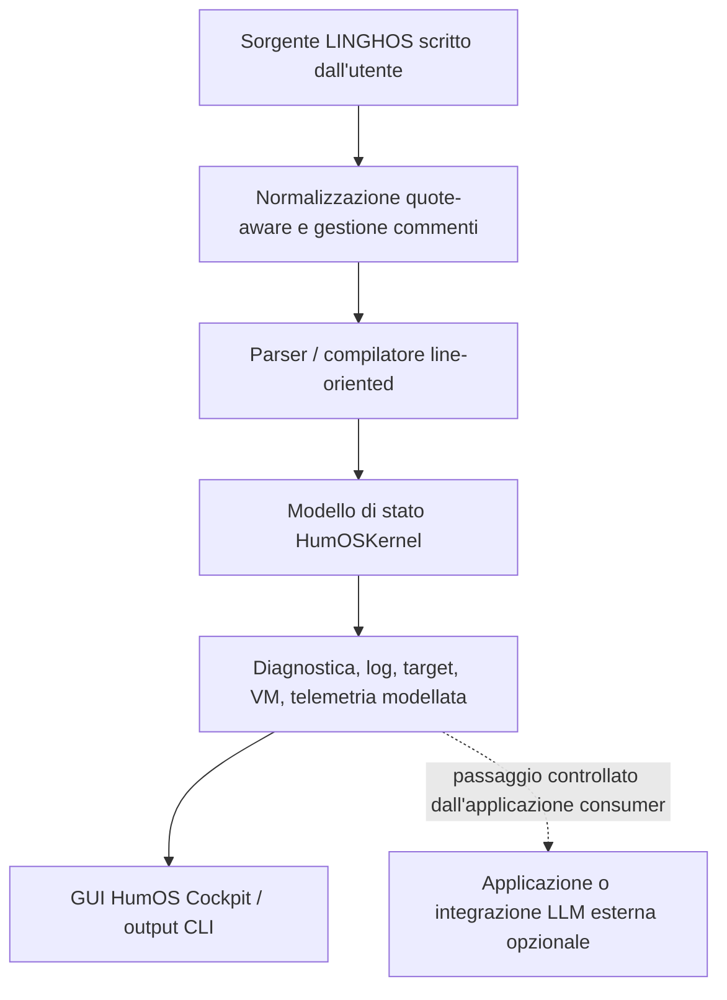

# Guida Sviluppatori HumOS & LINGHOS

**Package:** `linghos 1.0.0` · **Specifica architetturale:** `2.1.0-REV4` · **Python minimo:** `3.8`

## 1. Scopo e ambito

HumOS applica concetti dei sistemi operativi alla gestione cognitiva. Il repository distribuisce un package Python, il compilatore e l'interprete line-oriented LINGHOS, un modello di stato in memoria, persistenza JSON locale, un'interfaccia CLI e la GUI browser-based **HumOS Cockpit**.

Questa guida descrive il software effettivamente presente nel repository. L'architettura più ampia descritta nelle specifiche e nei protocolli comprende obiettivi di progetto che non sono ancora funzionalità runtime.

> **Limiti dell'implementazione:** Il package distribuito non classifica automaticamente input in linguaggio naturale o sfoghi emotivi, non costruisce un AST formale, non isola processi o macchine virtuali del sistema operativo, non acquisisce segnali biometrici, non applica un watchdog G.A.P. per i loop, non implementa `RAM.purge()` o `TRIGGER.kill_switch()` e non chiama un LLM esterno. I valori runtime di VM, RAM, BPM e difese sono modelli applicativi.

Consulta la [sezione sullo stato d'implementazione nella specifica](SPEC_IT.md#13-stato-dellimplementazione-e-limiti-di-conformita).

## 2. Cosa viene eseguito oggi

Il percorso di esecuzione locale attuale è:



Il compilatore restituisce un risultato strutturato contenente `compiler_meta`, `diagnostics`, `telemetry` modellata, record di target e VM, passaggi di soluzione, log e registro dei simboli. Il Cockpit locale visualizza il risultato e offre editing visuale e gestione degli scenari.

Il compilatore e l'interprete CLI sono due percorsi line-oriented distinti. Condividono la normalizzazione lessicale e la scansione dei blocchi, ma non costituiscono un'implementazione AST formale e non garantiscono comportamento identico per ogni costrutto del linguaggio descritto nella specifica.

## 3. Sottoinsieme del linguaggio supportato

I costrutti seguenti hanno percorsi implementati nel compilatore e/o nell'interprete attuali. Il loro comportamento esatto è definito dal codice e dai test di regressione, non dalla specifica di progetto più ampia.

| Costrutto | Ruolo attuale |
| :--- | :--- |
| `#include` | Registra un modulo nominato nel kernel / registro simboli |
| `Get:` | Registra target, alias e valori di peso |
| `Set_CriticVal` | Imposta la criticità di un target nel percorso del compilatore |
| `@Start>(...)` / `ON>` | Associa target a un modello VM in memoria |
| `Call >>` | Invoca una skill/azione di stato supportata dal kernel |
| `/SET_Lockdown_Mode` | Applica uno stato di lockdown modellato |
| `/SET_Attack_Mode` | Imposta la modalità attack modellata |
| `Take_DOWN` / `Close` | Aggiorna lo stato modellato delle connessioni e dei ponti |
| `OVR >>` | Imposta override difensivi modellati |
| `BE>` | Imposta un'etichetta di comportamento modellata |
| `IF(...)` | Valuta una condizione supportata dal kernel e processa il relativo blocco |
| `Echo(...)` | Registra un messaggio nel log runtime |
| `<<@end` | Registra il marcatore di terminazione dello script |

`Main()` funge da wrapper sorgente; non è una funzione compilata in un AST. I primitivi di progetto con notazione puntata come `RAM.alloc()`, `THREAD.spawn()` e `TRIGGER.kill_switch()` non sono implementati come comandi nativi del runtime.

### Esempio minimo

```linghos
Get: Review(review)[6];
Set_CriticVal >> review = [7];

Main() {
    @Start>(HP_EXT_Defense_VM) {
        ON> review;
    }

    IF(CS_EXPOSED) {
        Call >> Ice_shield;
        Call >> Double_Bottom_Shield;
    }

    Echo("Review isolata nella VM difensiva modellata");
    <<@end
}
```

I valori numerici e l'assegnazione VM in questo esempio sono input del modello di stato HumOS. Non creano una macchina virtuale del sistema operativo e non misurano lo stato fisiologico di una persona.

## 4. Avviare il Cockpit

Dalla root del repository:

```bash
python3 src/app.py
```

L'applicazione si lega al loopback e stampa l'URL locale, normalmente `http://127.0.0.1:8080`. Se la porta predefinita è occupata, usa l'indirizzo stampato dal processo.

La GUI browser è implementata in [`src/linghos/cockpit.html`](../src/linghos/cockpit.html). Include editor LINGHOS, controlli visuali per target/difese, telemetria modellata, gestione simboli e persistenza scenari.

Il servizio HTTP locale accetta richieste JSON fino a 1 MiB e verifica l'origine delle richieste POST del browser. Non autentica utenti o processi locali. Mantienilo sul loopback; non esporlo tramite interfacce di rete pubbliche, reverse proxy o tunnel.

## 5. Usare l'interfaccia a riga di comando

Dalla directory del package:

```bash
cd src
python3 -m linghos --help
python3 -m linghos run ../examples/adhd_ram_flush.lgh
python3 -m linghos repl
python3 -m linghos gui
```

È anche possibile installare il package in locale:

```bash
cd src
python3 -m pip install .
```

Consulta [`src/README.md`](../src/README.md) per le istruzioni specifiche del package.

## 6. Protocollo G.A.P. e limiti di sicurezza

Il protocollo inglese identifica GAP-001 come **Active Paranoia Management**; il titolo del protocollo italiano è **Gestione Attiva delle Paranoie**. G.A.P. descrive un modello cognitivo di contenimento e risposta. Il runtime attuale fornisce stati modellati per target/VM e alcune azioni difensive, ma non implementa il watchdog descritto, l'isolamento sandbox a livello di sistema operativo o il kill-switch forzato.

Leggi la [Politica di Sicurezza](../SECURITY.md), la [Politica di Sicurezza italiana](SECURITY_IT.md) e il [Protocollo G.A.P.-001](../protocols/it/GAP-001-protocol.md) prima di formulare affermazioni di sicurezza sul progetto.

## 7. Integrazione LLM e benchmark

Il repository non distribuisce un client LLM né una pipeline completa da input grezzo a LLM. Un'applicazione esterna può consumare l'output del compilatore e scegliere di inoltrare uno stato serializzato a un modello, applicando i propri controlli di consenso, privacy, validazione e sicurezza.

In questo repository non sono presenti benchmark riproducibili di riduzione token, tasso di allucinazione o latenza end-to-end. I valori numerici vanno considerati stime non verificate fino alla pubblicazione di un corpus, versioni di tokenizer/modello, script di misura, numero di esecuzioni e risultati grezzi. Un parsing deterministico non rende deterministica l'inferenza LLM a valle.

## 8. Test e build

Dalla root del repository:

```bash
PYTHONPATH=src python3 -m unittest discover -s tests -v
python3 -m compileall -q src tests
```

Per creare il package Python:

```bash
cd src
python3 -m pip wheel . --no-deps
```

GitHub Actions esegue la suite di regressione sulla matrice di versioni Python dichiarata e costruisce il package. I comandi locali sopra riportati sono i controlli di base usati per i contributi.

## 9. Documentazione correlata

- [README principale](../README.md) — panoramica e avvio rapido.
- [Specifica LINGHOS](SPEC_IT.md) · [LINGHOS specification in English](SPEC.md).
- [Guida sviluppatori inglese](GUIDE.md).
- [Note linguistiche LINGHOS in inglese](en/LINGHOS.md) · [note LINGHOS italiane](it/LINGHOS.md).
- [Linee guida per i contributi](CONTRIBUTING_IT.md) · [Contribution guidelines](../CONTRIBUTING.md).
