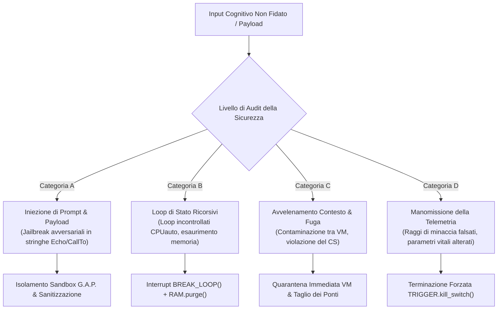

# Politica di Sicurezza Cognitiva per HumOS & LINGHOS
**Identificatore Documento:** `SEC-POLICY-20261108-IT`  
**Stato dello Standard:** `Politica di Sicurezza del Progetto & Guida alla Divulgazione delle Vulnerabilità`  
**Classificazione:** `Architettura di Sicurezza Runtime & Modello delle Minacce`  
**Contatto Sicurezza:** [SystemAdmin01 su GitHub](https://github.com/SystemAdmin01)  

---

## 1. Modello di Sicurezza Cognitiva & Scenario delle Minacce

I sistemi HumOS operano sull'interfaccia critica tra la cognizione biologica umana e gli agenti di inferenza basati su Large Language Model (LLM). In questa architettura, i fallimenti di sicurezza non si limitano ai tradizionali buffer overflow o exploit di rete; comprendono **vulnerabilità cognitive** capaci di provocare blocchi da loop mentale, avvelenamento del prompt, deviazione stocastica delle decisioni o violazioni dei confini del contesto.

L'obiettivo fondamentale dell'Architettura di Sicurezza Cognitiva di HumOS è garantire che nessun payload in ingresso — sia esso generato da attori esterni malevoli, da feedback avversariale dell'LLM o da stati emotivi interni ad alta eccitazione — possa compromettere il **Core Self (`CS_SECURE`)** o causare l'esaurimento incontrollato delle risorse dell'Host.

---

## 2. Classi di Vulnerabilità Rilevanti

Le seguenti classi di vulnerabilità sono formalmente considerate nell'ambito delle valutazioni di sicurezza, delle segnalazioni di bug e degli audit di penetration test:

### 2.1 Categoria A: Vettori di Iniezione Cognitiva (CIV)
- **Iniezione Avversariale di Payload:** Sequenze di escape annidate all'interno di istruzioni `Echo("...")` o `Get: Variabile(alias)` progettate per ingannare l'interprete LLM a valle, spingendolo a ignorare le istruzioni di sistema o a eseguire azioni esterne non autorizzate.
- **Iniezione Cognitiva Indiretta:** Flussi di testo ostili ricevuti tramite comunicazioni esterne (email, messaggi Slack, notifiche social) strutturati per innescare blocchi automatici ad alta criticità.

### 2.2 Categoria B: Loop Associativi Fuori Controllo & Saturazione di Stato (RSL)
- **Loop Ricorsivi della CPU:** Payload exploit che attivano stati di loop indefiniti in `Assoc_Engine` in cui la condizione `Assoc_Engine.status == LOOP` non viene interrotta, portando l'allocazione della memoria di lavoro al $100\%$ e causando il blocco cognitivo completo.
- **Inondazione del Context Window:** Input deliberatamente non demodulati studiati per consumare migliaia di token in continue rivalutazioni cicliche.

### 2.3 Categoria C: Avvelenamento del Contesto & Fuga tra VM (CPB)
- **Fuga Perimetrale:** Variabili di dato che oltrepassano una sandbox personale isolata (`PRS_VM`) o una sandbox ambientale (`LP_Ambient_VM`) riversandosi nel Core Self protetto (`CS_KERNEL`) senza transitare attraverso `Double_Bottom_Shield`.
- **Dirottamento della Fedeltà:** Exploit che alterano le percentuali di fedeltà dei target o riaprono ponti di comunicazione sigillati (`Close(all)`) senza l'esplicita autenticazione dell'operatore.

### 2.4 Categoria D: Falsificazione della Telemetria & Alterazione degli Invarianti (TIT)
- **Manipolazione della Prossimità Spaziale:** Manomissione delle variabili di calcolo tale da posizionare falsamente un target ostile al di fuori dell'orbita critica ($r > 150\text{px}$ anziché $r < 55\text{px}$).
- **Occultamento dei Parametri Vitali:** Soppressione degli alert fisiologici (es. mascheramento di $BPM \ge 120$) per impedire l'attivazione automatica di `Ice_shield` o dei cicli di respiro fisiologico.

---

## 3. Invarianti di Isolamento delle Sandbox (Architettura G.A.P.)

> **Limiti dell'implementazione (package 1.0.0):** Questa politica descrive i controlli previsti e il modello delle minacce; non costituisce una certificazione di sicurezza. Il runtime attuale modella lo stato di target e VM, ma non fornisce isolamento VM a livello di sistema operativo, un watchdog G.A.P. per i loop o il primitivo documentato `TRIGGER.kill_switch()`. Il server Cockpit si lega al loopback, rifiuta le richieste POST browser cross-origin e limita i body JSON a 1 MiB. Non autentica utenti o processi locali. Non esporlo tramite interfacce pubbliche, reverse proxy o tunnel.

Il sottosistema **G.A.P.** (**Guard, Analyze, Patch**) definisce il modello di contenimento e risposta previsto dal progetto. L'applicazione nel runtime è parziale; consulta i limiti d'implementazione qui sotto.

### 3.1 Applicazione Rigorosa dei Confini di Memoria
1. **Esposizione Zero Senza Scudo:** Quando viene rilevata la condizione `CS_EXPOSED`, il Core Vault attiva immediatamente `Ice_shield` (disaccoppiamento termico) e `Double_Bottom_Shield` (firewall semantico). Nessun dato grezzo può raggiungere il Core senza transitare attraverso il filtro semantico.
2. **Quarantena Rigida in VM:** Qualsiasi target dichiarato con punteggio di minaccia $\ge 7.0$ viene forzato all'interno di `HP_EXT_Defense_VM`. Gli è precluso qualsiasi accesso a segmenti di memoria di lavoro condivisa o thread ambientali.
3. **Garanzia di Interruzione del Loop:** Se un ciclo associativo supera il limite di tick dichiarato (`TIMEOUT = [30]`), `G.A.P.` esegue un hard `BREAK_LOOP(X)` forzando lo stato `SET_VALUE(X, UNDEFINED)`. Qualsiasi elaborazione speculativa viene interrotta definitivamente.

### 3.2 Aborto Obbligatorio dell'Esecuzione tramite `TRIGGER.kill_switch()`
L'obiettivo architetturale è richiedere un'interruzione immediata (`TRIGGER.kill_switch()`) al verificarsi delle seguenti condizioni critiche. Questo primitivo non è implementato dal runtime attuale:
- **Vettore di Stato Corrotto:** L'AST contiene nodi sintatticamente non validi o invarianti contraddittori (es. asserzione di `CS_SECURE` mentre `core_connected == True` su un target in lockdown).
- **Firma di Iniezione Rilevata:** Una variabile di input contiene sintassi di exploit attiva mirata ai tokenizer degli LLM a valle.
- **Soglia di Saturazione Biometrica:** Il battito cardiaco autonomo supera $130\text{ BPM}$ o il carico della memoria di lavoro tocca il $95\%$.

#### Garanzie dell'Aborto Invariante:
All'attivazione di `TRIGGER.kill_switch()`:
1. Tutti i canali di comunicazione vengono troncati: `Close(all) > bridges`.
2. La fedeltà verso i target viene azzerata: `Fidelity = 0%`.
3. Il distacco emotivo è assoluto: `Take_DOWN(all) > Core`.
4. Gli override vengono imposti: `OVR >> (DDS, ADS)`.
5. L'host entra in cold standby a fedeltà zero fino all'autenticazione manuale dell'operatore.

---

## 4. Matrice di Gravità delle Minacce & Finestre Obiettivo di Risoluzione

Le vulnerabilità segnalate al Security Team di HumOS vengono classificate secondo il modello **Cognitive Security Vulnerability Scoring (CSVS)**:

| Livello di Gravità | Definizione della Minaccia | Impatto Operativo | Finestra Obiettivo di Risoluzione* |
| :--- | :--- | :--- | :--- |
| **CRITICA** | Violazione diretta del Core Vault (`CS_UNLOCKED`); loop ricorsivo inarrestabile con blocco cognitivo totale; prompt injection che causa esecuzione di tool esterni non autorizzati. | Perdita totale dei confini cognitivi; grave disregolazione emotiva; dispatch arbitrario dell'LLM. | **Risoluzione entro 24 Ore** |
| **ALTA** | Mancato isolamento di un target ad alta minaccia ($C \ge 8$) nella sandbox `G.A.P.`; perdita di memoria in `RAM.alloc()` con progressivo esaurimento delle risorse; mancato contenimento del thermal throttling da parte di `Ice_shield`. | Saturazione della memoria di lavoro ($>85\%$); fuoriuscita di stimoli ansiogeni acuti; perdita del focus operativo. | **Risoluzione entro 72 Ore** |
| **MEDIA** | Minore travaso di contesto tra istanze VM non-core (`LP_Ambient_VM` $\rightarrow$ `PRS_VM`); imprecisione nel calcolo del raggio di prossimità spaziale ($\pm 15\text{px}$ di margine d'errore); apprendimento non deterministico nel registro dei simboli. | Incremento anomalo dei token; prioritizzazione difensiva sub-ottimale; lieve deriva della telemetria. | **Risoluzione entro 7 Giorni** |
| **BASSA** | Difetto estetico di rendering della telemetria nell'interfaccia SVG del Cockpit; discrepanza non critica nel timestamp dei log; warning del parser su casi limite privi di mutazione di stato. | Impatto operativo trascurabile; nessuna compromissione della sicurezza. | **Risoluzione entro 14 Giorni** |

---

## 5. Protocollo di Divulgazione & Segnalazione Responsabile

Adottiamo una procedura di divulgazione strutturata e responsabile. **Non** divulgare vulnerabilità pubblicamente prima di aver coordinato la segnalazione con il maintainer. I tempi di risposta non sono attualmente garantiti da uno SLA formale.

### 5.1 Fasi di Segnalazione
1. **Invio della Segnalazione:** Utilizza [GitHub Private Vulnerability Reporting](https://github.com/SystemAdmin01/HumOS/security/advisories) se è abilitato per il repository. In caso contrario, contatta il maintainer tramite il [profilo GitHub](https://github.com/SystemAdmin01). Non inviare report all'indirizzo segnaposto `security@humos.local`.
2. **Formato del Payload Richiesto:**
   - Descrizione dettagliata del vettore di vulnerabilità cognitiva.
   - Minimal Reproducible Example (MRE) scritto in sintassi `.lghos` che dimostri l'exploit.
   - Flusso di input grezzo che bypassa la demodulazione o innesca la ricorsione incontrollata.
   - Stato telemetrico osservato rispetto al comportamento invariante atteso.
3. **Presa in Carico & Conferma:** Il maintainer prenderà in carico e valuterà le segnalazioni in base alla propria disponibilità; non sono garantiti tempi di conferma o risoluzione.
4. **Periodo di Embargo:** Concorda le tempistiche di divulgazione con il maintainer; non presumere l'esistenza di un periodo fisso di embargo.
5. **Bollettino Pubblico & Riconoscimenti:** Al rilascio della patch, viene pubblicato un bollettino ufficiale di sicurezza (`SEC-ADV-YYYYMMDD-XX`), con attribuzione del merito al ricercatore.

---

**Le finestre indicate sono obiettivi di pianificazione, non SLA contrattuali né tempi di risposta garantiti.*

*Gestito da SystemAdmin01.*  
*Repository Ufficiale:* [https://github.com/SystemAdmin01/HumOS](https://github.com/SystemAdmin01/HumOS)
