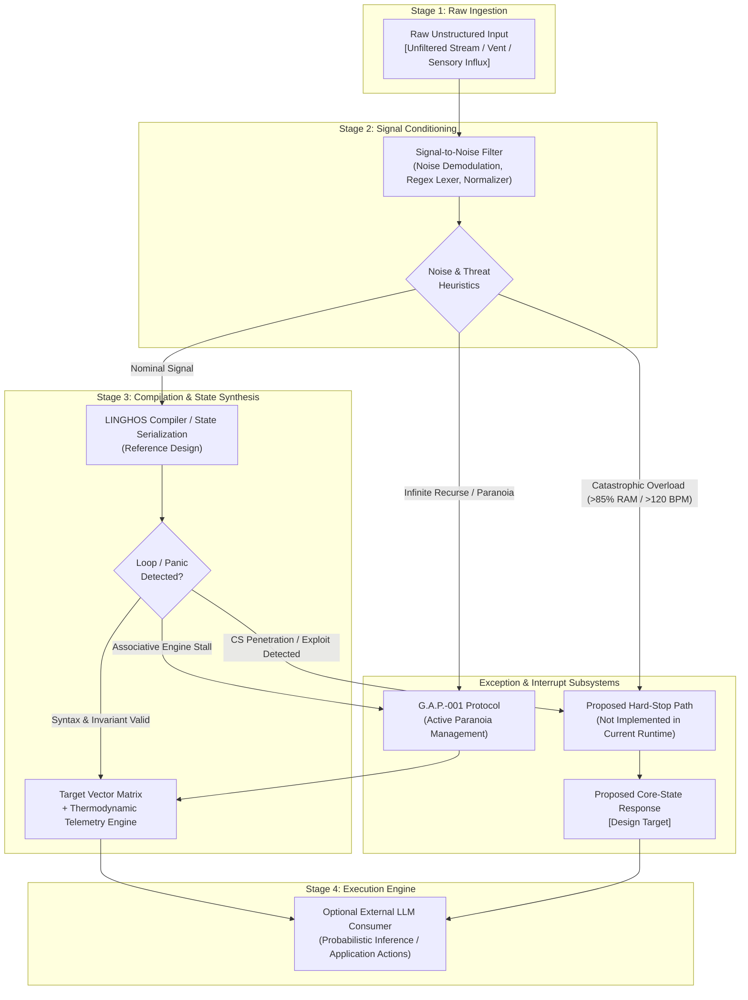

# HumOS // LINGHOS Architectural Core Specification
**Document Version:** `2.1.0-REV4`  
**Standard Status:** `Formal Technical Specification`  
**Classification:** `Runtime Engine Architecture & Cognitive DSL Contract`  
**Maintainer:** `SystemAdmin01`  

---

## 1. Philosophy & Personal Syntax Disclaimer

### 1.1 Nature of the Specification
LINGHOS (**Language for Interfacing Neurodivergent Gestalt Human Operating Systems**) is an **Opinionated Personal Cognitive Syntax**. It is a deterministic, high-throughput Domain-Specific Language (DSL) architected specifically to map volatile, unstructured, neurodivergent internal states (ADHD hyper-arousal, cognitive overload, emotional dysregulation, and associative loop cascades) into discrete, verifiable state vectors.

### 1.2 Core Mission & Operational Mechanics

Unstructured cognitive input can be difficult to inspect and reuse in computational workflows. Repetition, missing context, and ambiguous references may increase prompt size or make downstream interpretation less predictable. These are design motivations for HumOS, not measured claims about all natural-language prompts or all LLMs.

LINGHOS is designed to provide an explicit representation layer: users can name targets, assign modeled attributes, and describe supported actions with a compact DSL. This can make the resulting state easier to inspect and pass to another application. The current package does not automatically extract that state from free text, and structured input does not guarantee zero hallucinations or deterministic behavior from an external LLM.

---

### 1.3 Implementation Status and Conformance Boundary

This document is the **architectural target specification**, not a claim that every primitive below is implemented by the current Python runtime. The package version (`1.0.0`) and this specification revision (`2.1.0-REV4`) are independent version lines.

**Implemented in the current repository:** line-oriented parsing/compilation for the supported subset (`#include`, `Get:`, `Set_CriticVal`, `@Start>`, `Call >>`, lockdown/attack directives, `Take_DOWN`, `Close`, `OVR`, `BE`, `IF`, `Echo`, and `<<@end`); in-memory target and VM *models*; a subset of skill state transitions; compiler diagnostics and modeled telemetry; CLI and local Cockpit.

**Design-level / not yet enforced as runtime primitives:** `RAM.alloc()`, `RAM.free()`, `RAM.purge()`, `THREAD.*`, `BREAK_LOOP()`, `SET_VALUE()`, `TRIGGER.kill_switch()`, a G.A.P. watchdog with a real timeout, operating-system VM/process isolation, hardware biometric acquisition, and automatic raw-language-to-state demodulation. The VM objects are application data models, not operating-system virtual machines. The package does not itself call an external LLM; integration snippets that construct prompts are examples for downstream applications.

The compiler and serializer are deterministic for a given input and runtime state where implemented. This does **not** guarantee deterministic or hallucination-free behavior from an external LLM. Treat all unimplemented primitives in the following reference as proposed semantics until their runtime implementation and tests are added.

---

## 2. Processing Pipeline Mechanics

The diagram below describes the intended reference architecture, not the execution path shipped in the current package. See section 1.3 for the implemented components.



### 2.1 Stage 1: Raw Unstructured Ingestion
- **Input Type:** Biological / natural-language stream (unfiltered emotional prose, sensory overload logs, conversational transcripts).
- **Format Contract:** UTF-8 raw text string.
- **Latency Window:** Immediate capture buffer.
- **Payload Schema:**
  ```json
  {
    "stream_id": "RAW-20261108-001",
    "timestamp_epoch": 1794148501.104,
    "source": "Host_BioFeedback_Afferent",
    "raw_payload": "Everyone is demanding answers at the same time, my heart is pounding at 135 bpm, Slack notifications are breaking my focus, I cannot prioritize, and I feel like everything will crash if I make one mistake right now."
  }
  ```

### 2.2 Stage 2: Signal-to-Noise Demodulation
- **Processing Unit:** Deterministic regular-expression sanitizer and entity extractor.
- **Transformation Contract:**
  1. Strip colloquial adjectives, repeated punctuation, and catastrophic metaphors.
  2. Extract isolated entities: Human Targets (`T`), Urgency Weights (`W`), Criticality Indices (`C`).
  3. Demodulate biological telemetry: Heart Rate Estimate (`BPM`), Working Memory Load (`RAM_EST`).
- **Payload Schema:**
  ```json
  {
    "signal_id": "SIG-20261108-001",
    "targets_identified": [
      {"identifier": "DemandingPeers", "alias": "prs", "weight": 8, "criticality": 9},
      {"identifier": "NotificationStream", "alias": "ntf", "weight": 7, "criticality": 6}
    ],
    "telemetry_est": {
      "bpm": 135,
      "ram_load_pct": 92,
      "cs_state_est": "EXPOSED"
    },
    "paranoia_flag": false,
    "abort_flag": false
  }
  ```

### 2.3 Stage 3: LINGHOS AST Compilation
- **Processing Unit:** Lexical Scanner, Shift-Reduce Parser, Symbol Registry (`SymbolRegistry`), and Thermodynamic Matrix Evaluator.
- **Transformation Contract:**
  1. Map identifiers against `GLOBAL_REGISTRY` (macro families, skills, directives, VM types).
  2. Synthesize strict LINGHOS AST with concrete instruction blocks (`Main()`, `@Start>`, `Call >>`, `/SET_Lockdown_Mode`).
  3. Calculate spatial proximity radii in Cartesian/polar coordinates relative to the Core Vault ($r = \max(50.0, 175.0 - (W \cdot 6.5 + C \cdot 5.5))$).
  4. Generate thermodynamic invariant matrix (`ram_pct`, `heart_rate_bpm`, `thermal_throttling`).
- **Payload Schema:**
  ```json
  {
    "ast_id": "AST-20261108-001",
    "linghos_source": "#include <Executive_Control>\n#include <Hardware_Regulation>\nGet: DemandingPeers(prs)[8], NotificationStream(ntf)[7];\nSet_CriticVal >> prs = [9]\nMain() {\n  Call >> RAM.alloc(BUFFER_ISOLATION, 256MB);\n  @Start>(HP_EXT_Defense_VM) {\n    ON> prs, ntf;\n  }\n  Call >> Ice_shield;\n  Call >> Double_Bottom_Shield;\n  Call >> THREAD.suspend(ntf);\n  <<@end\n}",
    "runtime_state": {
      "ram_pct": 34,
      "bpm": 74,
      "cs_state": "SECURE",
      "thermal_throttling": false
    }
  }
  ```

### 2.4 Stage 4: LLM Semantic Engine Execution
- **Processing Unit:** Downstream Language Model Reasoning Kernel.
- **Transformation Contract:**
  1. Consume AST and state vector directly into system prompt context.
  2. Zero stochastic drift: prompt specifies deterministic function calling strictly bounded by the declared LINGHOS state vector.
  3. Output: Concrete operational directives, boundary communications, or physiological clamp triggers.

---

## 3. Exhaustive Primitive Reference Matrix

### 3.1 Memory Layer

#### 3.1.1 `RAM.alloc()`
- **Syntax Spec:**
  ```linghos
  Call >> RAM.alloc(<buffer_label>, <memory_size_mb>);
  ```
- **Arguments/Parameters:**
  - `buffer_label` (`Identifier`): Symbolic identifier of the reserved cognitive buffer (e.g., `SCRATCH_PAD`, `INCIDENT_BUFFER`, `EMOTIONAL_QUARANTINE`).
  - `memory_size_mb` (`Integer`): Working memory allocation unit in Megabytes (Range: `16` to `512`).
- **Cognitive Memory Behavior:**
  Allocates an isolated temporary partition in mental working memory. Dedicates working memory lanes exclusively to the bound task or target, preventing associative leakage into adjacent cognitive threads. Deducts allocated value from total free mental headroom.
- **Side-Effects & Fallbacks:**
  If allocation exceeds available working headroom (`total_ram > 85%`), the compiler raises `ERR_RAM_SATURATION`, initiates automatic thread eviction, and forces a clamp fallback to `RAM.purge()`.
- **Concrete Before / After:**
  - *Raw Thought String:*
    ```text
    "I have three massive projects due tomorrow and my brain is trying to think about all three simultaneously while panicking."
    ```
  - *Compiled LINGHOS State Vector:*
    ```linghos
    Call >> RAM.alloc(PROJECT_A_BUFFER, 128MB);
    Call >> RAM.alloc(PROJECT_B_BUFFER, 64MB);
    Call >> RAM.alloc(PROJECT_C_BUFFER, 64MB);
    // State Vector: { RAM_ACTIVE: 256MB, RAM_UTILIZATION: 48%, THREAD_ISOLATION: LOCKED }
    ```

---

#### 3.1.2 `RAM.free()`
- **Syntax Spec:**
  ```linghos
  Call >> RAM.free(<buffer_label>);
  ```
- **Arguments/Parameters:**
  - `buffer_label` (`Identifier`): Identifier of the active allocation to deallocate.
- **Cognitive Memory Behavior:**
  Closes the working context of a completed or dismissed task. Flushes short-term intermediate tokens associated with `buffer_label`, releasing cognitive bandwidth back to the primary system pool.
- **Side-Effects & Fallbacks:**
  If `buffer_label` is currently bound to an active high-priority VM (`HP_EXT_Defense_VM`), the engine generates `WARN_BUFFER_ORPHANED`. The fallback routes deallocation to the VM termination sequence before reclaiming memory.
- **Concrete Before / After:**
  - *Raw Thought String:*
    ```text
    "Meeting with the auditor ended twenty minutes ago, but I keep replaying what he said about item four."
    ```
  - *Compiled LINGHOS State Vector:*
    ```linghos
    Call >> RAM.free(AUDITOR_INTERACTION_BUFFER);
    // State Vector: { BUFFER_STATUS: RELEASED, REPLAY_LOOP: ABORTED, WORKING_RAM_RECLAIMED: 64MB }
    ```

---

#### 3.1.3 `RAM.purge()`
- **Syntax Spec:**
  ```linghos
  Call >> RAM.purge();
  ```
- **Arguments/Parameters:**
  - None (`Void`).
- **Cognitive Memory Behavior:**
  Executes an immediate hard reset of all non-essential working memory threads. Flushes open associative chains, terminates background cognitive polling, and resets working RAM allocation to baseline nominal levels ($\le 20\%$). Corresponds to the macro directive `Call >> Drop_All_Background_Threads;`.
- **Side-Effects & Fallbacks:**
  Active uncommitted thoughts in volatile memory are dropped without persistence. Fallback restores Core default state (`CS_SECURE`) and loads minimal bootstrap context.
- **Concrete Before / After:**
  - *Raw Thought String:*
    ```text
    "My head feels like it's going to explode, twenty browser tabs open in my mind, intrusive thoughts about emails, rent, code, and bills."
    ```
  - *Compiled LINGHOS State Vector:*
    ```linghos
    Call >> RAM.purge();
    Call >> RAM_Diagnostic;
    // State Vector: { RAM_UTILIZATION: 18%, ORPHAN_THREADS: 0, ACTIVE_BUFFERS: [CS_KERNEL] }
    ```

---

### 3.2 Process Layer

#### 3.2.1 `THREAD.spawn()`
- **Syntax Spec:**
  ```linghos
  Call >> THREAD.spawn(<thread_id>, <target_ref>, <priority_level>);
  ```
- **Arguments/Parameters:**
  - `thread_id` (`Identifier`): Unique symbolic reference (e.g., `TH_ANALYZE_INCIDENT`).
  - `target_ref` (`Identifier`): Associated target alias declared via `Get:`.
  - `priority_level` (`Enum`): `LP` (Low Priority / Ambient) or `HP` (High Priority / Foreground).
- **Cognitive Memory Behavior:**
  Initializes an isolated processing routine dedicated to a single objective or input variable. Binds execution context strictly within a designated sandbox (`LP_Ambient_VM` or `HP_EXT_Defense_VM`).
- **Side-Effects & Fallbacks:**
  If concurrent thread count exceeds cognitive threshold ($n > 4$), the engine rejects the call with `ERR_THREAD_SATURATION` and forces queuing under `PRS_VM`.
- **Concrete Before / After:**
  - *Raw Thought String:*
    ```text
    "I need to quietly observe how my team responds to the re-org announcement without getting emotionally sucked in."
    ```
  - *Compiled LINGHOS State Vector:*
    ```linghos
    Get: TeamOrgUpdate(org)[4];
    Main() {
      Call >> THREAD.spawn(TH_OBSERVE_TEAM, org, LP);
      @Start>(LP_Ambient_VM) { ON> org; }
      Call >> sniffer(IN&OUT_resources);
      <<@end
    }
    // State Vector: { THREADS_ACTIVE: 1, PRIORITY: LP, EMOTIONAL_EXPOSURE: 0.0 }
    ```

---

#### 3.2.2 `THREAD.suspend()`
- **Syntax Spec:**
  ```linghos
  Call >> THREAD.suspend(<thread_id>);
  ```
- **Arguments/Parameters:**
  - `thread_id` (`Identifier`): Targeted active process identifier.
- **Cognitive Memory Behavior:**
  Freezes instruction execution on the target thread without destroying its state. Thread is moved to dormant swap space; CPU clock cycles dedicated to this problem are throttled to 0%.
- **Side-Effects & Fallbacks:**
  If the suspended thread holds an active lock on an emotional trigger, `Ice_shield` is automatically deployed to prevent latent leakage while frozen.
- **Concrete Before / After:**
  - *Raw Thought String:*
    ```text
    "I can't deal with this family argument right now while I am writing production code. Put it on ice."
    ```
  - *Compiled LINGHOS State Vector:*
    ```linghos
    Call >> THREAD.suspend(TH_FAMILY_DISPUTE);
    Call >> Ice_shield;
    // State Vector: { TH_FAMILY_DISPUTE: SUSPENDED, CPU_CYCLES: 0%, SHIELD_ACTIVE: TRUE }
    ```

---

#### 3.2.3 `THREAD.kill()`
- **Syntax Spec:**
  ```linghos
  Call >> THREAD.kill(<thread_id>);
  ```
- **Arguments/Parameters:**
  - `thread_id` (`Identifier`): Target process to terminate.
- **Cognitive Memory Behavior:**
  Forcefully de-schedules the thread, destroys its local sandbox context, unlinks associated memory buffers, and emits a termination log entry (`SYS_THREAD_TERMINATED`).
- **Side-Effects & Fallbacks:**
  If the thread refuses termination due to intrusive cognitive recursion, the runtime escalates to `G.A.P.` loop interrupt.
- **Concrete Before / After:**
  - *Raw Thought String:*
    ```text
    "Stop thinking about that rude comment from that stranger online. Completely kill that thought."
    ```
  - *Compiled LINGHOS State Vector:*
    ```linghos
    Call >> THREAD.kill(TH_ONLINE_TROLL);
    Call >> RAM.free(TROLL_DATA_BUFFER);
    // State Vector: { TH_ONLINE_TROLL: TERMINATED, CORE_RESONANCE: ZERO }
    ```

---

### 3.3 Security & Interception Layer

#### 3.3.1 `G.A.P.-001` (Active Paranoia Management)
- **Syntax Spec:**
  ```linghos
  Call >> G.A.P.protocol;
  // Protocol identity: Active Paranoia Management.
  // The operations below are proposed semantics, not implemented runtime primitives.
  ```
- **Arguments/Parameters:**
  - Implicit context or explicit target: `X` (`Variable / Threat Payload`).
  - `TIMEOUT` (`Integer`, optional): Max clock ticks allowed before hard break (Default: `[30]`).
- **Cognitive Memory Behavior:**
  Intervenes when unclassified inputs trigger runaway associative loops (`Assoc_Engine.status == LOOP`). Prevents associative cascading by enforcing `SET_VALUE(X, UNDEFINED)`. Quarantines `X` inside `PRS_VM` at low criticality ($C = 3$) without attempting resolution.
- **Side-Effects & Fallbacks:**
  Bypasses normal classification logic. If `Assoc_Engine` fails to break, triggers `RAM.purge()` and isolates the Core Self (`CS_SECURE`).
- **Concrete Before / After:**
  - *Raw Thought String:*
    ```text
    "My boss just sent a message saying 'we need to talk tomorrow morning' with no context. I am spinning out imagining fifty reasons I am about to get fired."
    ```
  - *Compiled LINGHOS State Vector:*
    ```linghos
    #include <Assoc_Engine>
    #include <para.md>
    #define X = CallTo > BossMessage
    Main() {
      When(analyst AND sniffer) {
        RELEVE(X);
        SET_FLAG(X, UNCLASSIFIED);
      }
      CPUauto {
        Get:: X;
        IF (Assoc_Engine.status == LOOP) {
          BREAK_LOOP(X);
          Call >> Drop_All_Background_Threads;
          Call >> RAM_Diagnostic;
        }
      }
      SET_VALUE(X, UNDEFINED);
      @Start>(PRS_VM) {
        priority = HP;
        ON> X;
        SET_CriticVal >> X = [3];
      }
      Call >> Ice_shield;
      RETURN(X, UNDEFINED);
      <<@end
    }
    // State Vector: { GAP_STATUS: PATCHED, CLOCK_LOOP: TERMINATED, CS: SECURE, THREAT: QUARANTINED }
    ```

---

### 3.4 Emergency Abort Layer

#### 3.4.1 `TRIGGER.kill_switch()`
- **Syntax Spec:**
  ```linghos
  TRIGGER.kill_switch();
  // Operates equivalent to:
  // /SET_Lockdown_Mode { Take_DOWN(all)>Core; Close(all)>bridges; OVR>>(DDS,ADS); }
  ```
- **Arguments/Parameters:**
  - None (`Void`). Invoked globally or from exception handlers.
- **Cognitive Memory Behavior:**
  Total disconnect of afferent sensory and emotional feedback loops. Instantaneous drop of target fidelity to $0\%$, severing of all communication bridges (`Close(all)`), detachment of the Core Self from external variable influence (`Take_DOWN > Core`), and activation of cryogenic insulation (`Ice_shield`).
- **Side-Effects & Fallbacks:**
  External social interaction is hard-muted until manual operator reset. System enters cold-standby mode; heart rate decelerates via forced physiological sigh directives (`Execute >> Physiological_Sigh(Rapporto_4_7_8)`).
- **Concrete Before / After:**
  - *Raw Thought String:*
    ```text
    "Full panic attack. Sensory overload. High heart rate, trembling, cannot speak, people are crowding me, I need to shut down immediately."
    ```
  - *Compiled LINGHOS State Vector:*
    ```linghos
    /SET_Lockdown_Mode {
      Take_DOWN(all) > (ALL)'s_Core
      Close(all) > (ALL)'s_bridges
      OVR >> (DDS, ADS)
    }
    Execute >> Physiological_Sigh(Rapporto_4_7_8);
    Call >> Ice_shield;
    TRIGGER.kill_switch();
    // State Vector: { CORE_STATUS: ISOLATED, FIDELITY: 0%, BRIDGES: CLOSED, BPM_CLAMP: ACTIVE }
    ```

---

## 4. Architectural Summary Reference Table

| Layer | Primitive | Arity / Signature | Target State | Invariant Guarantee |
| :--- | :--- | :--- | :--- | :--- |
| **Memory** | `RAM.alloc()` | `(label: ID, size: INT)` | Isolated Buffer | Allocates isolated working lanes; halts cross-thread leaks. |
| **Memory** | `RAM.free()` | `(label: ID)` | Reclaimed Pool | Releases context-window tokens; purges orphan loops. |
| **Memory** | `RAM.purge()` | `()` | Factory Nominal | Hard reset of cognitive working memory to $\le 20\%$ utilization. |
| **Process** | `THREAD.spawn()` | `(id: ID, target: ID, prio: ENUM)` | Sandboxed Routine | Strictly bounds thread within declared VM architecture. |
| **Process** | `THREAD.suspend()`| `(id: ID)` | Dormant Swap | Drops CPU cycles to 0%; engages `Ice_shield` freeze. |
| **Process** | `THREAD.kill()` | `(id: ID)` | De-allocated Task | Forcible termination and eradication of cognitive loops. |
| **Security**| `G.A.P.` | `(payload: VAR, [timeout: INT])` | Triage Quarantine | Halts associative tilt; sets value to `UNDEFINED`. |
| **Abort** | `TRIGGER.kill_switch()`| `()` | Total Lockdown | Closes all bridges; sets Fidelity to 0%; enforces `CS_SECURE`. |

---

*Authored and verified under the HumOS Specification Group.*  
*Repository Reference:* [https://github.com/SystemAdmin01/HumOS](https://github.com/SystemAdmin01/HumOS)
