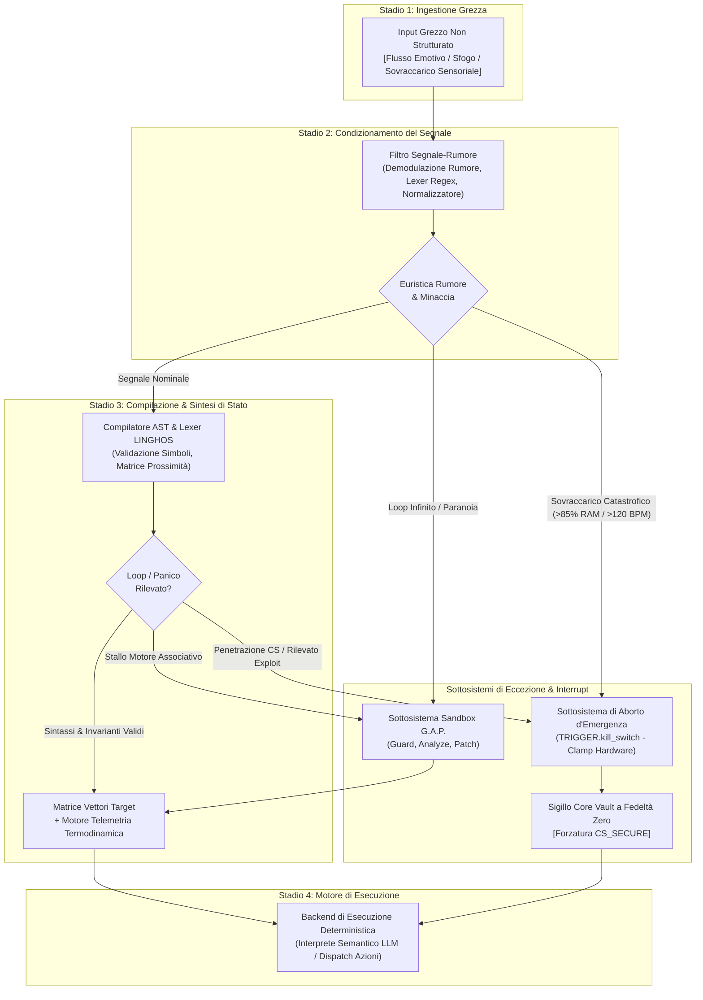

# Specifica Architetturale Core di HumOS & LINGHOS
**Versione Documento:** `2.1.0-REV4`  
**Stato dello Standard:** `Specifica Tecnica Formale`  
**Classificazione:** `Architettura del Runtime Engine & Contratto del DSL Cognitivo`  
**Maintainer:** `SystemAdmin01`  

---

## 1. Filosofia & Dichiarazione di Sintassi Personale

### 1.1 Natura della Specifica
LINGHOS (**Language for Interfacing Neurodivergent Gestalt Human Operating Systems**) è una **Sintassi Cognitiva Personale Rigorosa**. Si tratta di un Domain-Specific Language (DSL) deterministico ad alta efficienza, progettato specificamente dall'autore per mappare stati interni neurodivergenti e instabili (iper-attivazione da ADHD, sovraccarico cognitivo, disregolazione emotiva e cascate di loop associativi) in vettori di stato discreti e verificabili.

### 1.2 Obiettivo Primario & Meccanica Operativa
L'espressione emotiva non strutturata e il journaling soggettivo tradizionale generano una perdita di segnale critica quando interfacciati con sistemi computazionali e Large Language Model (LLM):
- **Inflazione dei Token:** Lo sfogo emotivo non strutturato satura il context window con token ridondanti e ciclici.
- **Ambiguità Semantica:** La prosa soggettiva introduce deviazioni stocastiche e allucinazioni nei motori di inferenza LLM a valle.
- **Latenza & Thermal Throttling:** I loop di feedback mentali non strutturati consumano la memoria di lavoro (RAM cognitiva) senza mai convergere verso una soluzione.

LINGHOS agisce come una barriera di astrazione tra la neurochimica biologica e l'esecuzione cognitiva deterministica. Imponendo token lessicali rigorosi, dichiarazioni di confine perimetrale (`Sandbox`), e un bilancio termodinamico delle risorse (`RAM`, `BPM`, `Stato CS`), LINGHOS estrae il segnale utile eliminando il rumore emotivo. I vettori di stato risultanti consentono un parsing semantico privo di allucinazioni, un tracciamento verificabile delle transizioni di stato e l'esecuzione deterministica delle istruzioni.

---

### 1.3 Stato dell'Implementazione e Limiti di Conformità

Questo documento è una **specifica architetturale di riferimento**, non la dichiarazione che ogni primitivo descritto sia già implementato nel runtime Python. La versione del package (`1.0.0`) e la revisione della specifica (`2.1.0-REV4`) appartengono a due linee di versione distinte.

**Implementato nel repository attuale:** parsing/compilazione lineare del sottoinsieme supportato (`#include`, `Get:`, `Set_CriticVal`, `@Start>`, `Call >>`, direttive lockdown/attack, `Take_DOWN`, `Close`, `OVR`, `BE`, `IF`, `Echo` e `<<@end`); *modelli in memoria* per target e VM; un sottoinsieme di transizioni di stato delle skill; diagnostica del compilatore e telemetria modellata; CLI e Cockpit locale.

**A livello di specifica / non ancora applicato come primitivo runtime:** `RAM.alloc()`, `RAM.free()`, `RAM.purge()`, `THREAD.*`, `BREAK_LOOP()`, `SET_VALUE()`, `TRIGGER.kill_switch()`, un watchdog G.A.P. con timeout effettivo, isolamento di processi/VM a livello di sistema operativo, acquisizione biometrica hardware e demodulazione automatica da linguaggio naturale a vettore di stato. Gli oggetti VM sono modelli applicativi, non macchine virtuali del sistema operativo. Il package non invoca direttamente un LLM esterno; gli esempi di generazione dei prompt sono integrazioni illustrative per applicazioni a valle.

Il compilatore e il serializzatore sono deterministici per uno stesso input e stato runtime, nei percorsi implementati. Questo **non** garantisce risposte deterministiche o prive di allucinazioni da parte di un LLM esterno. I primitivi non implementati descritti nelle sezioni successive vanno considerati semantica proposta fino all'aggiunta del runtime e dei relativi test.

---

## 2. Meccanica della Pipeline di Elaborazione

Il runtime di HumOS elabora gli input cognitivi attraverso una pipeline deterministica a 4 stadi. Ogni passaggio di trasformazione rispetta un contratto strutturale esplicito.



### 2.1 Stadio 1: Ingestione Grezza Non Strutturata
- **Tipo di Input:** Flusso biologico / linguaggio naturale (prosa emotiva non filtrata, log di sovraccarico sensoriale, trascrizioni conversazionali).
- **Contratto di Formato:** Stringa di testo grezzo UTF-8.
- **Finestra di Latenza:** Buffer di cattura istantaneo.
- **Schema del Payload:**
  ```json
  {
    "stream_id": "RAW-20261108-001",
    "timestamp_epoch": 1794148501.104,
    "source": "Host_BioFeedback_Afferent",
    "raw_payload": "Tutti mi stanno chiedendo risposte contemporaneamente, ho il cuore a mille a 135 bpm, le notifiche di Slack distruggono il focus, non riesco a stabilire priorità e sento che se sbaglio una virgola crolla tutto adesso."
  }
  ```

### 2.2 Stadio 2: Demodulazione Segnale-Rumore
- **Unità di Elaborazione:** Sanitizzatore ed estrattore di entità basato su espressioni regolari deterministiche.
- **Contratto di Trasformazione:**
  1. Rimozione di avverbi superflui, punteggiatura ciclica e metafore catastrofiche.
  2. Estrazione delle entità isolate: Target Umani (`T`), Pesi Emotivi d'Urgenza (`W`), Indici di Criticità (`C`).
  3. Demodulazione della telemetria biologica: Stima Battito Cardiaco (`BPM`), Carico della Memoria di Lavoro (`RAM_EST`).
- **Schema del Payload:**
  ```json
  {
    "signal_id": "SIG-20261108-001",
    "targets_identified": [
      {"identifier": "DemandingPeers", "alias": "prs", "weight": 8, "criticality": 9},
      {"identifier": "NotificationStream", "alias": "ntf", "weight": 7, "criticality": 6}
    ],
    "telemetry_est": {
      "bpm": 135,
      "ram_load_pct": 92,
      "cs_state_est": "EXPOSED"
    },
    "paranoia_flag": false,
    "abort_flag": false
  }
  ```

### 2.3 Stadio 3: Compilazione AST LINGHOS
- **Unità di Elaborazione:** Scanner Lessicale, Parser Shift-Reduce, Registro Simboli (`SymbolRegistry`) e Valutatore della Matrice Termodinamica.
- **Contratto di Trasformazione:**
  1. Mappatura degli identificatori su `GLOBAL_REGISTRY` (famiglie macro, skill, direttive, template VM).
  2. Sintesi dell'AST LINGHOS rigoroso con blocchi di istruzioni concreti (`Main()`, `@Start>`, `Call >>`, `/SET_Lockdown_Mode`).
  3. Calcolo dei raggi spaziali di prossimità in coordinate polari/cartesiane rispetto al Core Vault ($r = \max(50.0, 175.0 - (W \cdot 6.5 + C \cdot 5.5))$).
  4. Generazione della matrice degli invarianti termodinamici (`ram_pct`, `heart_rate_bpm`, `thermal_throttling`).
- **Schema del Payload:**
  ```json
  {
    "ast_id": "AST-20261108-001",
    "linghos_source": "#include <Executive_Control>\n#include <Hardware_Regulation>\nGet: DemandingPeers(prs)[8], NotificationStream(ntf)[7];\nSet_CriticVal >> prs = [9]\nMain() {\n  Call >> RAM.alloc(BUFFER_ISOLATION, 256MB);\n  @Start>(HP_EXT_Defense_VM) {\n    ON> prs, ntf;\n  }\n  Call >> Ice_shield;\n  Call >> Double_Bottom_Shield;\n  Call >> THREAD.suspend(ntf);\n  <<@end\n}",
    "runtime_state": {
      "ram_pct": 34,
      "bpm": 74,
      "cs_state": "SECURE",
      "thermal_throttling": false
    }
  }
  ```

### 2.4 Stadio 4: Esecuzione del Motore Semantico LLM
- **Unità di Elaborazione:** Kernel di Inferenza del Modello Linguistico a valle.
- **Contratto di Trasformazione:**
  1. Consumo dell'AST e del vettore di stato all'interno del contesto del prompt di sistema.
  2. Zero deviazione stocastica: il prompt vincola l'LLM a un function calling deterministico rigorosamente racchiuso nei confini dichiarati nel vettore di stato LINGHOS.
  3. Output: Direttive operative concrete, comunicazioni di confine relazionale o trigger di clamp fisiologico.

---

## 3. Matrice Completa dei Primitivi

### 3.1 Livello Memoria (Memory Layer)

#### 3.1.1 `RAM.alloc()`
- **Specifica Sintattica:**
  ```linghos
  Call >> RAM.alloc(<buffer_label>, <memory_size_mb>);
  ```
- **Argomenti / Parametri:**
  - `buffer_label` (`Identificatore`): Etichetta simbolica del buffer cognitivo riservato (es. `SCRATCH_PAD`, `INCIDENT_BUFFER`, `EMOTIONAL_QUARANTINE`).
  - `memory_size_mb` (`Intero`): Unità di allocazione della memoria di lavoro in Megabyte (Intervallo: `16` a `512`).
- **Comportamento della Memoria Cognitiva:**
  Alloca una partizione temporanea isolata nella working memory mentale. Dedica i canali di memoria di lavoro esclusivamente al task o target associato, impedendo la dispersione associativa nei thread adiacenti. Sottrae il valore allocato dal totale della memoria mentale disponibile.
- **Effetti Collaterali & Fallback:**
  Se l'allocazione supera il limite disponibile (`total_ram > 85%`), il compilatore solleva `ERR_RAM_SATURATION`, avvia l'espulsione automatica dei thread orfani e forza il fallback su `RAM.purge()`.
- **Esempio Concreto Prima / Dopo:**
  - *Stringa di Pensiero Grezzo:*
    ```text
    "Ho tre progetti enormi in scadenza domani e il mio cervello sta cercando di pensare a tutti e tre contemporaneamente andando in tilt totale."
    ```
  - *Vettore di Stato Compilato LINGHOS:*
    ```linghos
    Call >> RAM.alloc(PROJECT_A_BUFFER, 128MB);
    Call >> RAM.alloc(PROJECT_B_BUFFER, 64MB);
    Call >> RAM.alloc(PROJECT_C_BUFFER, 64MB);
    // Vettore di Stato: { RAM_ACTIVE: 256MB, RAM_UTILIZATION: 48%, THREAD_ISOLATION: LOCKED }
    ```

---

#### 3.1.2 `RAM.free()`
- **Specifica Sintattica:**
  ```linghos
  Call >> RAM.free(<buffer_label>);
  ```
- **Argomenti / Parametri:**
  - `buffer_label` (`Identificatore`): Identificatore dell'allocazione attiva da rilasciare.
- **Comportamento della Memoria Cognitiva:**
  Chiude il contesto di lavoro di un task completato o archiviato. Esegue il flush dei token intermedi a breve termine legati a `buffer_label`, restituendo larghezza di banda cognitiva al pool primario.
- **Effetti Collaterali & Fallback:**
  Se `buffer_label` è vincolato a una VM attiva ad alta priorità (`HP_EXT_Defense_VM`), il motore genera `WARN_BUFFER_ORPHANED`. Il fallback instrada la deallocazione alla sequenza di terminazione della VM prima di liberare la memoria.
- **Esempio Concreto Prima / Dopo:**
  - *Stringa di Pensiero Grezzo:*
    ```text
    "La riunione con il revisore è finita venti minuti fa, ma continuo a rimuginare su cosa intendeva con il punto quattro."
    ```
  - *Vettore di Stato Compilato LINGHOS:*
    ```linghos
    Call >> RAM.free(AUDITOR_INTERACTION_BUFFER);
    // Vettore di Stato: { BUFFER_STATUS: RELEASED, REPLAY_LOOP: ABORTED, WORKING_RAM_RECLAIMED: 64MB }
    ```

---

#### 3.1.3 `RAM.purge()`
- **Specifica Sintattica:**
  ```linghos
  Call >> RAM.purge();
  ```
- **Argomenti / Parametri:**
  - Nessuno (`Void`).
- **Comportamento della Memoria Cognitiva:**
  Esegue un hard reset immediato di tutti i thread non essenziali nella memoria di lavoro. Svuota le catene associative aperte, interrompe il polling cognitivo in background e ripristina la RAM ai livelli nominali ($\le 20\%$). Corrisponde operativamente alla macro-direttiva `Call >> Drop_All_Background_Threads;`.
- **Effetti Collaterali & Fallback:**
  I pensieri attivi non consolidati nella memoria volatile vengono scartati senza persistenza. Il fallback ripristina lo stato predefinito del Core (`CS_SECURE`) e ricarica il contesto minimo di avvio.
- **Esempio Concreto Prima / Dopo:**
  - *Stringa di Pensiero Grezzo:*
    ```text
    "Sento la testa scoppiare, venti tab aperti nel cervello, pensieri continui su email arretrate, affitto, codice da consegnare e bollette."
    ```
  - *Vettore di Stato Compilato LINGHOS:*
    ```linghos
    Call >> RAM.purge();
    Call >> RAM_Diagnostic;
    // Vettore di Stato: { RAM_UTILIZATION: 18%, ORPHAN_THREADS: 0, ACTIVE_BUFFERS: [CS_KERNEL] }
    ```

---

### 3.2 Livello Processi (Process Layer)

#### 3.2.1 `THREAD.spawn()`
- **Specifica Sintattica:**
  ```linghos
  Call >> THREAD.spawn(<thread_id>, <target_ref>, <priority_level>);
  ```
- **Argomenti / Parametri:**
  - `thread_id` (`Identificatore`): Riferimento simbolico univoco (es. `TH_ANALYZE_INCIDENT`).
  - `target_ref` (`Identificatore`): Alias del target associato dichiarato con `Get:`.
  - `priority_level` (`Enum`): `LP` (Bassa Priorità / Ambientale) o `HP` (Alta Priorità / Primo Piano).
- **Comportamento della Memoria Cognitiva:**
  Inizializza una routine operativa isolata dedicata a un singolo obiettivo o variabile in ingresso. Vincola il contesto di esecuzione rigorosamente all'interno della sandbox designata (`LP_Ambient_VM` o `HP_EXT_Defense_VM`).
- **Effetti Collaterali & Fallback:**
  Se il numero di thread concorrenti supera la soglia cognitiva ($n > 4$), il motore rigetta la chiamata con `ERR_THREAD_SATURATION` e forza l'accodamento all'interno di `PRS_VM`.
- **Esempio Concreto Prima / Dopo:**
  - *Stringa di Pensiero Grezzo:*
    ```text
    "Devo osservare in silenzio come reagisce il team all'annuncio della riorganizzazione senza farmi trascinare emotivamente."
    ```
  - *Vettore di Stato Compilato LINGHOS:*
    ```linghos
    Get: TeamOrgUpdate(org)[4];
    Main() {
      Call >> THREAD.spawn(TH_OBSERVE_TEAM, org, LP);
      @Start>(LP_Ambient_VM) { ON> org; }
      Call >> sniffer(IN&OUT_resources);
      <<@end
    }
    // Vettore di Stato: { THREADS_ACTIVE: 1, PRIORITY: LP, EMOTIONAL_EXPOSURE: 0.0 }
    ```

---

#### 3.2.2 `THREAD.suspend()`
- **Specifica Sintattica:**
  ```linghos
  Call >> THREAD.suspend(<thread_id>);
  ```
- **Argomenti / Parametri:**
  - `thread_id` (`Identificatore`): Identificatore del processo attivo da congelare.
- **Comportamento della Memoria Cognitiva:**
  Blocca l'esecuzione delle istruzioni sul thread indicato senza distruggerne lo stato. Il thread viene trasferito nell'area di swap; i cicli di clock della CPU dedicati a questo problema vengono azzerati allo 0%.
- **Effetti Collaterali & Fallback:**
  Se il thread sospeso detiene un blocco su un trigger emotivo, `Ice_shield` viene attivato automaticamente per prevenire dispersioni latenti durante lo stato dormiente.
- **Esempio Concreto Prima / Dopo:**
  - *Stringa di Pensiero Grezzo:*
    ```text
    "Non posso affrontare questa lite familiare adesso mentre sto programmando in produzione. Mettila da parte e congelala."
    ```
  - *Vettore di Stato Compilato LINGHOS:*
    ```linghos
    Call >> THREAD.suspend(TH_FAMILY_DISPUTE);
    Call >> Ice_shield;
    // Vettore di Stato: { TH_FAMILY_DISPUTE: SUSPENDED, CPU_CYCLES: 0%, SHIELD_ACTIVE: TRUE }
    ```

---

#### 3.2.3 `THREAD.kill()`
- **Specifica Sintattica:**
  ```linghos
  Call >> THREAD.kill(<thread_id>);
  ```
- **Argomenti / Parametri:**
  - `thread_id` (`Identificatore`): Processo target da terminare immediatamente.
- **Comportamento della Memoria Cognitiva:**
  Rimuove forzatamente il thread dalla pianificazione, distrugge la relativa sandbox locale, scollega i buffer di memoria associati ed emette un log di terminazione (`SYS_THREAD_TERMINATED`).
- **Effetti Collaterali & Fallback:**
  Se il thread rifiuta la terminazione a causa di una ricorsione cognitiva intrusiva, il runtime esegue l'escalation verso l'interrupt di loop `G.A.P.`.
- **Esempio Concreto Prima / Dopo:**
  - *Stringa di Pensiero Grezzo:*
    ```text
    "Devo smetterla di pensare a quel commento sgradevole scritto da uno sconosciuto online. Uccidi completamente quel pensiero."
    ```
  - *Vettore di Stato Compilato LINGHOS:*
    ```linghos
    Call >> THREAD.kill(TH_ONLINE_TROLL);
    Call >> RAM.free(TROLL_DATA_BUFFER);
    // Vettore di Stato: { TH_ONLINE_TROLL: TERMINATED, CORE_RESONANCE: ZERO }
    ```

---

### 3.3 Livello Sicurezza & Intercettazione (Security & Interception Layer)

#### 3.3.1 `G.A.P.` (Guard, Analyze, Patch)
- **Specifica Sintattica:**
  ```linghos
  Call >> G.A.P.protocol;
  // Espansione formale:
  // Guard(X)   -> Intercetta la variabile caotica X
  // Analyze(X) -> Rileva lo stato di loop in Assoc_Engine
  // Patch(X)   -> BREAK_LOOP(X) + SET_VALUE(X, UNDEFINED) + Sandboxing
  ```
- **Argomenti / Parametri:**
  - Contesto implicito o target esplicito: `X` (`Variabile Caotica / Payload di Minaccia`).
  - `TIMEOUT` (`Intero`, opzionale): Cicli massimi ammessi prima del break forzato (Predefinito: `[30]`).
- **Comportamento della Memoria Cognitiva:**
  Interviene quando input non classificati innescano loop associativi incontrollati (`Assoc_Engine.status == LOOP`). Previene la cascata associativa imponendo `SET_VALUE(X, UNDEFINED)`. Mette in quarantena `X` all'interno di `PRS_VM` a bassa criticità ($C = 3$) senza tentare alcuna risoluzione forzata.
- **Effetti Collaterali & Fallback:**
  Bypassa la logica di classificazione standard. Se `Assoc_Engine` fallisce l'interruzione, attiva `RAM.purge()` e isola completamente il Core Self (`CS_SECURE`).
- **Esempio Concreto Prima / Dopo:**
  - *Stringa di Pensiero Grezzo:*
    ```text
    "Il mio capo mi ha scritto 'dobbiamo parlare domani mattina' senza aggiungere altro. Il mio cervello sta andando in tilt immaginando cinquanta motivi per cui sto per essere licenziato."
    ```
  - *Vettore di Stato Compilato LINGHOS:*
    ```linghos
    #include <Assoc_Engine>
    #include <para.md>
    #define X = CallTo > BossMessage
    Main() {
      When(analyst AND sniffer) {
        RELEVE(X);
        SET_FLAG(X, UNCLASSIFIED);
      }
      CPUauto {
        Get:: X;
        IF (Assoc_Engine.status == LOOP) {
          BREAK_LOOP(X);
          Call >> Drop_All_Background_Threads;
          Call >> RAM_Diagnostic;
        }
      }
      SET_VALUE(X, UNDEFINED);
      @Start>(PRS_VM) {
        priority = HP;
        ON> X;
        SET_CriticVal >> X = [3];
      }
      Call >> Ice_shield;
      RETURN(X, UNDEFINED);
      <<@end
    }
    // Vettore di Stato: { GAP_STATUS: PATCHED, CLOCK_LOOP: TERMINATED, CS: SECURE, THREAT: QUARANTINED }
    ```

---

### 3.4 Livello Aborto d'Emergenza (Emergency Abort Layer)

#### 3.4.1 `TRIGGER.kill_switch()`
- **Specifica Sintattica:**
  ```linghos
  TRIGGER.kill_switch();
  // Equivale operativamente a:
  // /SET_Lockdown_Mode { Take_DOWN(all)>Core; Close(all)>bridges; OVR>>(DDS,ADS); }
  ```
- **Argomenti / Parametri:**
  - Nessuno (`Void`). Invocato a livello globale o dagli handler di eccezione.
- **Comportamento della Memoria Cognitiva:**
  Disconnessione immediata di tutti i loop afferenti sensoriali ed emotivi. Azzeramento istantaneo della fedeltà relazionale verso i target allo $0\%$, chiusura ermetica di tutti i canali di comunicazione materiale (`Close(all)`), distacco del Core Self dall'influenza esterna (`Take_DOWN > Core`) e attivazione dell'isolamento criogenico (`Ice_shield`).
- **Effetti Collaterali & Fallback:**
  L'interazione sociale esterna viene silenziata tassativamente fino al ripristino manuale dell'operatore. Il sistema entra in modalità cold-standby; la frequenza cardiaca viene decelerata tramite clamp fisiologico forzato (`Execute >> Physiological_Sigh(Rapporto_4_7_8)`).
- **Esempio Concreto Prima / Dopo:**
  - *Stringa di Pensiero Grezzo:*
    ```text
    "Attacco di panico completo. Sovraccarico sensoriale totale. Tachicardia, tremore, blocco verbale, troppa gente intorno, devo staccare la spina e spegnere tutto subito."
    ```
  - *Vettore di Stato Compilato LINGHOS:*
    ```linghos
    /SET_Lockdown_Mode {
      Take_DOWN(all) > (ALL)'s_Core
      Close(all) > (ALL)'s_bridges
      OVR >> (DDS, ADS)
    }
    Execute >> Physiological_Sigh(Rapporto_4_7_8);
    Call >> Ice_shield;
    TRIGGER.kill_switch();
    // Vettore di Stato: { CORE_STATUS: ISOLATED, FIDELITY: 0%, BRIDGES: CLOSED, BPM_CLAMP: ACTIVE }
    ```

---

## 4. Tabella Riassuntiva dei Primitivi

| Livello | Primitivo | Segnatura / Arità | Stato di Destinazione | Garanzia dell'Invariante |
| :--- | :--- | :--- | :--- | :--- |
| **Memoria** | `RAM.alloc()` | `(label: ID, size: INT)` | Buffer Isolato | Alloca canali isolati; arresta le dispersioni tra thread. |
| **Memoria** | `RAM.free()` | `(label: ID)` | Pool Rilasciato | Libera token nel context-window; elimina i loop orfani. |
| **Memoria** | `RAM.purge()` | `()` | Nominale di Fabbrica | Hard reset della memoria di lavoro a un utilizzo $\le 20\%$. |
| **Processi**| `THREAD.spawn()` | `(id: ID, target: ID, prio: ENUM)` | Routine in Sandbox | Racchiude rigorosamente il thread nella VM dichiarata. |
| **Processi**| `THREAD.suspend()`| `(id: ID)` | Swap Dormiente | Cicli CPU portati allo 0%; attiva la protezione `Ice_shield`. |
| **Processi**| `THREAD.kill()` | `(id: ID)` | Task Deallocato | Terminazione forzata ed eradicazione dei loop cognitivi. |
| **Sicurezza**| `G.A.P.` | `(payload: VAR, [timeout: INT])` | Quarantena Triage | Blocca il tilt associativo; fissa il valore a `UNDEFINED`. |
| **Abort** | `TRIGGER.kill_switch()`| `()` | Lockdown Totale | Chiude i ponti; fedeltà allo 0%; impone `CS_SECURE`. |

---

*Redatto e verificato dal Gruppo di Specifica HumOS.*  
*Repository di Riferimento:* [https://github.com/SystemAdmin01/HumOS](https://github.com/SystemAdmin01/HumOS)
